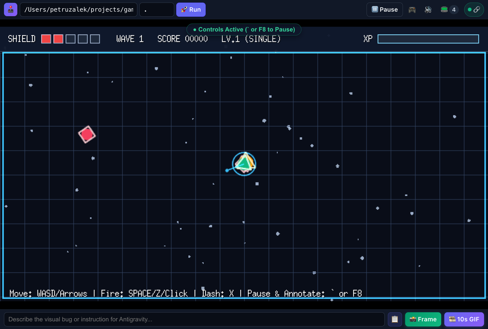
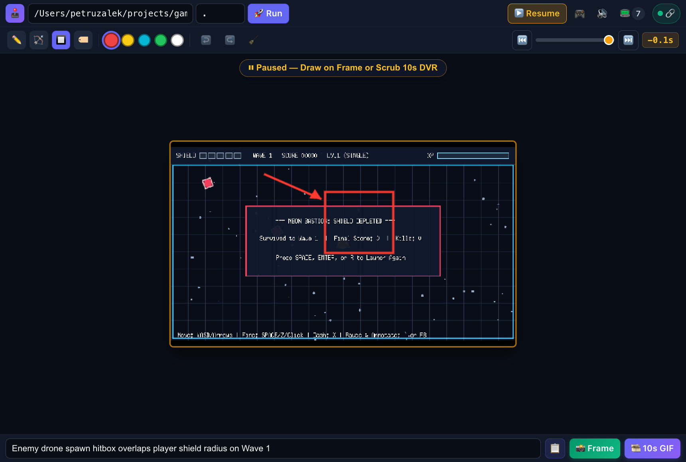
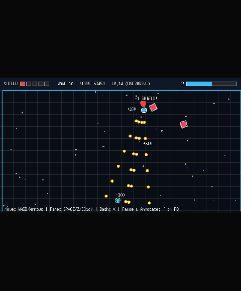
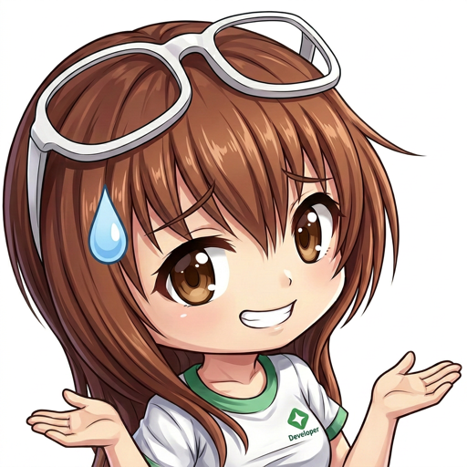

# Antigravity 2D Game Studio (`agy-game-studio`)

**Antigravity 2D Game Studio** is an all-in-one 2D game development plugin and live WebAssembly **Game Dev Studio** UI extension for [Google Antigravity](https://antigravity.google). Build 2D games in Go with [Ebitengine](https://ebitengine.org/) and Google Gemini, compile and playtest them live at 60 FPS in the side pane, rewind a 10-second DVR buffer, annotate visual bugs, and export 10-second animated GIF clips directly into your chat session.



---

## User-Level Installation

`agy-game-studio` ships with prebuilt UI assets (`dist/`) and uses Antigravity's bundled Node.js runtime and `sidecar_sdk`. Installing the plugin as a user requires **no `npm install` or frontend build step**: only a Go toolchain (`1.26+` recommended) to compile your games to WebAssembly (`GOOS=js GOARCH=wasm`), plus `uv` and `python3` when running `uv run skills/nano-banana/scripts/banana.py`, `uv run skills/lyria/scripts/lyria.py`, or `uv run skills/gemini-omni/scripts/omni.py` for AI image, music, and video cutscene generation.

### 1. Install the plugin

Choose the installation method for your Antigravity surface:

#### Antigravity CLI (`agy`)

Install directly from GitHub in your shell:

```bash
agy plugin install https://github.com/danicat/agy-game-studio
```

Or inside an interactive `agy` TUI session using `/plugin`:

```text
/plugin install https://github.com/danicat/agy-game-studio
```

#### Antigravity 2.0 and Antigravity IDE

Place the plugin directory in one of Antigravity's plugin discovery roots:

- **Global (all workspaces)**:
  - **macOS / Linux**: `~/.gemini/config/plugins/agy-game-studio`
  - **Windows**: `%USERPROFILE%\.gemini\config\plugins\agy-game-studio`

  ```bash
  git clone https://github.com/danicat/agy-game-studio.git ~/.gemini/config/plugins/agy-game-studio
  ```

- **Workspace (project-scoped)**:
  Place the plugin at `.agents/plugins/agy-game-studio` in your repository root, or declare its parent directory in `.agents/plugins.json` (workspace) or `~/.gemini/config/plugins.json` (global):

  ```json
  {
    "entries": [
      { "path": "/path/to/plugins" }
    ]
  }
  ```

### 2. Enable the plugin

1. If you created a new plugin directory manually on disk, **restart Antigravity** so it discovers the directory on startup.
2. In **Antigravity 2.0** or **Antigravity IDE**, open **Customizations** in the left sidebar, select the **Installed** tab, and verify **Antigravity 2D Game Studio** (`agy-game-studio`) is enabled. (Or run `/plugin` in chat / `agy plugin enable agy-game-studio` in the CLI.)
3. Once enabled, Antigravity automatically starts and supervises the `agy-game-studio/studio` sidecar process.

### 3. Open Game Dev Studio & start building

Use `/game-dev-studio` inside any Antigravity conversation to open the **Game Dev Studio** side panel (or click **⋮ -> Extensions -> Game Dev Studio** in the top-right corner of a conversation). Opening a registered `.music`, `.sfx`, `.sprite`, or `.aseprite` file opens **Game Dev Studio** with the relevant tab in focus:

- **Playtest tab in Game Dev Studio (`🎮 Playtest`)**: Open `sidecar://agy-game-studio/studio/playtest` to select a Go project folder via **Open Project** and click **🚀 Run** to compile and playtest Ebitengine WASM games at 60 FPS.
- **Sound tab in Game Dev Studio (`🎹 Sound` / Sound Editor)**: Open `sidecar://agy-game-studio/studio/sound` to open, edit, mix, save, and export `.music` (`Song` mode) and `.sfx` (`SFX` mode) files using mode-scoped **Open File**, **Open Artifact**, **Save**, and **Export** (`.wav`) modals alongside **GUI** / **Text** and **Wave** / **Spectrum** toggles and a 1:1 instrument-to-channel mixer.
- **Sprite tab in Game Dev Studio (`🎨 Sprites` / Sprite Editor)**: Open `sidecar://agy-game-studio/studio/sprite` to inspect, edit, save, and export `.sprite` and binary `.aseprite` containers using **Open File**, **Open Artifact**, **Save**, and **Export** alongside a `Visual` vs. `Text` toggle, `1× Once` lead-in frame flagging (`tag run 8 once, 9..11 loop`), `Play`/`Pause` (starts paused), `Speed`, `Backdrop`, and per-frame prompt comments.

### 4. Configure Vertex AI / Gemini Enterprise credentials for AI art, music & video (optional)

The `nano-banana` (`uv run skills/nano-banana/scripts/banana.py`), `lyria` (`uv run skills/lyria/scripts/lyria.py`), and `gemini-omni` (`uv run skills/gemini-omni/scripts/omni.py`) skills run via `uv` and `python3` using Google Cloud Vertex AI / Gemini Enterprise Application Default Credentials (ADC):

```bash
gcloud auth application-default login --billing-project YOUR_PROJECT_ID
export GOOGLE_CLOUD_PROJECT="YOUR_PROJECT_ID"
export GOOGLE_CLOUD_LOCATION="global"
export GOOGLE_GENAI_USE_VERTEXAI="true"
```

Run `./scripts/check_env.sh` at any time to verify Go, `wasm_exec.js`, Node.js, `uv`, Python 3, and your Gemini credentials.

---

## Game Dev Studio UI Extension (`sidecars/studio`)

Open **Game Dev Studio** in the right-hand side pane via `/game-dev-studio`, `[Game Dev Studio](sidecar://agy-game-studio/studio/playtest)`, `[Sound Editor](sidecar://agy-game-studio/studio/sound)`, `[Sprite Editor](sidecar://agy-game-studio/studio/sprite)`, or **⋮ -> Extensions -> Game Dev Studio**. All tabs share a standardized header menu (**Open Project** / **Open File**, **Open Artifact**, **Save**, and **Export**) aligned with Paint Studio (`agy-paint-studio`), without auto-populating dropdowns from internal skill directories:

- **Playtest Tab in Game Dev Studio (`🎮 Playtest`)**: Use **Open Project** to select your Go game folder and main package (e.g. `/path/to/game` or `/path/to/repo/cmd/game`) and click **🚀 Run**. The sidecar resolves `go.mod`, compiles with `GOOS=js GOARCH=wasm`, and streams any compiler or runtime panic tracebacks directly to chat.
- **60 FPS Zero-Copy DVR Ring Buffer**: Continuously records the last **10 seconds (250 frames @ 25 FPS)** onto GPU-backed 2D canvases without dropping frame rate.
- **Pause, Scrub & Annotate (`F8` or `` ` ``)**: Pause gameplay, scrub frame-by-frame through the 10s DVR timeline, draw boxes/arrows/callouts over visual bugs, and send either:
  - **📸 Frame**: Smart-cropped PNG screenshot (true-to-screen resolution when unannotated, or automatically expanded to include any margin notes drawn in the scratch space) + WASM console logs.
  - **🎞️ 10s GIF**: Pure 10-second animated GIF89a replay locked strictly to the game's screen resolution + WASM console logs.
- **Sound Tab in Game Dev Studio (`🎹 Sound` / Sound Editor)**: Live `.music` (`Song`) and `.sfx` (`SFX`) procedural audio workbench featuring mode-scoped **Open File** and **Open Artifact** (`.wav` is Export-only), **Save**, and **Export** (`.wav`), two-row toolbar action buttons to toggle **GUI** vs. **Text** mode and **Wave** vs. **Spectrum** (`< 260 Hz` FFT) visualizers, dual YM2612 FM and Apple CoreAudio synthesis, and a 1:1 instrument-to-channel Mute/Solo stems mixer.
- **Sprite Tab in Game Dev Studio (`🎨 Sprites` / Sprite Editor)**: Streamlined workbench for `.sprite` and direct binary `.aseprite` container files featuring **Open File** (`.sprite` or `.aseprite`), **Open Artifact**, **Save** (`.sprite`), and **Export** (`.aseprite`, `.png` sheet, or `.json` manifest), starting paused with a **Visual** / **Text** toggle, **`1× Once`** lead-in frame toggle (`tag run 8 once, 9..11 loop`), **Play**/**Pause**, **Speed**, **Backdrop**, and per-frame prompt comments.



### Exported 10s DVR Gameplay GIF



---

## Included Skills

| Skill | What it does |
| :--- | :--- |
| [`vibe-game-developer`](skills/vibe-game-developer/SKILL.md) | Primary entrypoint and workflow router that coordinates the end-to-end 2D game development lifecycle across design, engine architecture, visual assets, audio, playtesting, and Go quality control. |
| [`game-design`](skills/game-design/SKILL.md) | Interactive game co-creation workflow (`/grill-me`) and Game Design Document (`GDD.md`) authoring guide covering core loops, controls, camera projections, and asset pipeline choices across all 2D genres. |
| [`ebitengineer`](skills/ebitengineer/SKILL.md) | Engineering architecture and best practices for building 2D games in Go with Ebitengine v2, including scene state machines, virtual resolution scaling, fixed-timestep physics, zero-allocation draw loops, 4-byte aligned PCM audio, Kage shaders, and WebAssembly builds. |
| [`game-dev-studio`](skills/game-dev-studio/SKILL.md) | Opens the Game Dev Studio side-panel UI extension (`/game-dev-studio`) with the **Playtest tab** (`🎮 Playtest` for 60 FPS WASM + 10s DVR GIF bug annotation), **Sound tab / Sound Editor** (`🎹 Sound` for `.music` and `.sfx` editing), and **Sprite tab / Sprite Editor** (`🎨 Sprites` for `.sprite` and `.aseprite` inspection). |
| [`sprite-design`](skills/sprite-design/SKILL.md) | Complete guide and `.sprite` engine for 2D game sprites, tilesets, and frame animations in Ebitengine, featuring the 2-step AI Character Sheet to Sprite Grid normalization pipeline (`normalize` into `.sprite`, `.aseprite`, `.png`, and `.json`), procedural SDF/pixel-art `.sprite` definitions, and zero-allocation `AnimationController`. |
| [`nano-banana`](skills/nano-banana/SKILL.md) | Generates character turnaround sheets, `4x4` chroma-key sprite grids, tilesets, parallax backgrounds, and title screen art with Nano Banana (`gemini-nano-banana-2.1`, `gemini-3.1-flash-lite-image`, `gemini-3.1-flash-image`, `gemini-3-pro-image`) via `uv run skills/nano-banana/scripts/banana.py` with Vertex AI / Gemini Enterprise ADC. |
| [`procedural-sfx`](skills/procedural-sfx/SKILL.md) | Synthesizes 4-byte aligned 16-bit 44.1 kHz stereo PCM game sound effects in memory from `.sfx` DSL scripts with PolyBLEP anti-aliasing, 18 built-in archetype presets, SVF filter sweeps, 16-bit Galois LFSR chiptune noise, and production quality validation. |
| [`procedural-music`](skills/procedural-music/SKILL.md) | Composes, validates, and synthesizes multi-channel 16-bit stereo BGM from `.music` DSL scores using pure-Go SEGA Mega Drive YM2612 FM + SN76489 PSG synthesis or native macOS Apple CoreAudio GM instruments (`-apple`). |
| [`lyria`](skills/lyria/SKILL.md) | Generates 44.1 kHz stereo soundtracks, full vocal songs, and 30-second instrumental loops from text prompts or concept art using Google Lyria (`lyria-3.5` and `lyria-3-clip-preview`) via `uv run skills/lyria/scripts/lyria.py` with Vertex AI / Gemini Enterprise ADC. |
| [`gemini-omni`](skills/gemini-omni/SKILL.md) | Generates, edits, interpolates, extends, and upscales `3s` to `15s` animated video cutscenes (`360p` to `4k` at `24 FPS`) with native synchronized audio using Gemini Omni 1.2 Flash (`gemini-omni-1.2-flash`) and `gemini-omni-1.1-flash` via `uv run skills/gemini-omni/scripts/omni.py` and the Google Gen AI Interactions API with Vertex AI / Gemini Enterprise ADC. |
| [`godoctor`](skills/godoctor/SKILL.md) | Optional Go quality control and architectural safety toolset orchestrating `gofmt`, `goimports`, `go vet`, `modernize`, `golangci-lint`, compiler rollback gates, TestQuery SQLite analytics, and Selene mutation testing. |
| [`swarm-coding`](skills/swarm-coding/SKILL.md) | Optional divide-and-conquer multi-agent swarm orchestrator with Coordinator, Lead, and Specialist roles and strict Single Writer file boundaries for concurrent multi-package development. |
| [`parallel`](skills/parallel/SKILL.md) | Optional general-purpose task parallelization and subagent scaling engine for flat disjoint task fan-out, reactive worker queues, and Best-of-N tournaments. |

---

## Developer & Contributor Guide

Only contributors modifying Game Dev Studio's TypeScript frontend (`src/`), sidecar server (`server/`), or bundled skills need to install dev dependencies and rebuild `dist/`.

### 1. Local development setup

Clone the repository and symlink it into `~/.gemini/config/plugins/` so Antigravity loads your live working tree:

```bash
git clone git@github.com:danicat/agy-game-studio.git
cd agy-game-studio
ln -s "$(pwd)" ~/.gemini/config/plugins/agy-game-studio
./scripts/check_env.sh
```

### 2. Build, typecheck, and test

```bash
npm install
npm run build
npm run typecheck
npm test
```

`npm run build` typechecks the TypeScript source (`src/`) and runs Vite to produce the self-contained frontend bundle (`dist/index.html`, `dist/app.js`, `dist/styles.css`) so the committed `dist/` folder runs with zero external `node_modules`.

### 3. Debugging & hot-reloading the sidecar

Antigravity writes sidecar `stdout` and `stderr` to:

```text
~/.gemini/antigravity/sidecar_data/agy-game-studio/studio/logs/sidecar.log
```

- **Frontend changes (`src/`)**: Run `npm run build`, then refresh or close and reopen the Game Dev Studio panel. The sidecar server reads `dist/index.html`, `dist/app.js`, and `dist/styles.css` fresh from disk on every request.
- **Backend changes (`server/` or `sidecars/studio/`)**: Disable and re-enable **Antigravity 2D Game Studio** (`agy-game-studio`) in **Customizations → Installed** (or via `/plugin`) to restart the background sidecar process.

### 4. Standalone CLI helper scripts

```bash
# Validate and inspect 2D sprite containers (.sprite, .aseprite, .png, .json)
cd skills/sprite-design/scripts && go run . validate black_cat_anime.sprite black_cat_anime.aseprite

# Validate and synthesize procedural sound effects (.sfx) and 16-bit BGM (.music)
cd skills/procedural-sfx/scripts && go run . validate *.sfx
cd skills/procedural-music/scripts && go run . validate *.music

# Generate or edit images with Nano Banana, music tracks with Lyria, and video cutscenes with Gemini Omni 1.2 Flash via uv + python3
uv run skills/nano-banana/scripts/banana.py --help
uv run skills/lyria/scripts/lyria.py --help
uv run skills/gemini-omni/scripts/omni.py --help
```

---

## About the Author

DISCLAIMER: I AM NOT A GAME DEVELOPER.



I am [Daniela Petruzalek](https://linkedin.com/in/petruzalek), a Developer Relations Engineer at Google. I might not be a game developer, but I am a lifetime gamer and game collector. I enjoy using projects like this to teach software engineering, agentic coding, and creative ways to build with AI.

---

## Disclaimer

This is not an officially supported Google product.