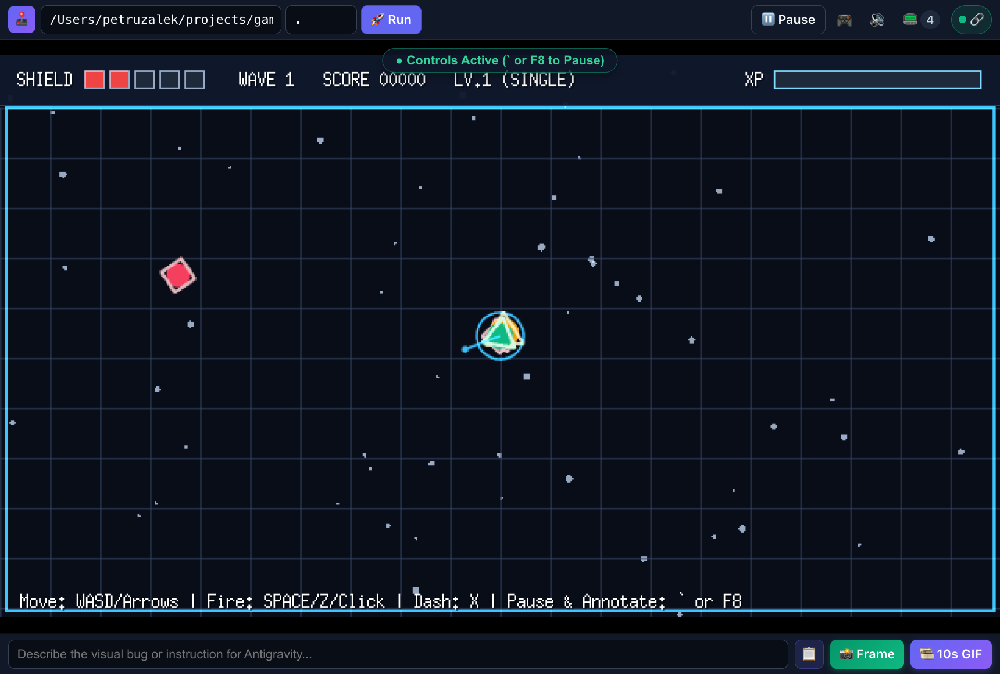
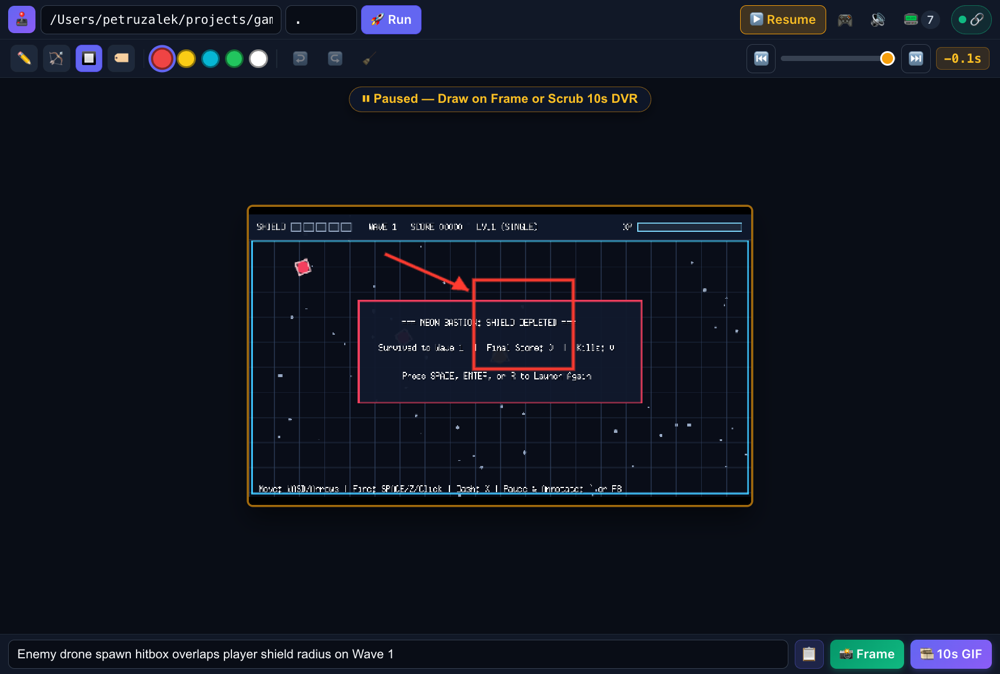
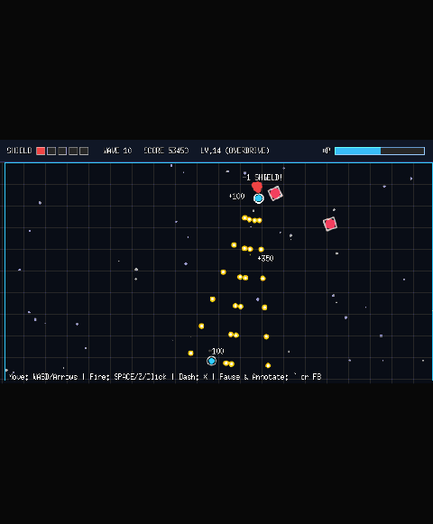

# Antigravity 2D Game Studio (`agy-game-studio`)

**Antigravity 2D Game Studio** is an all-in-one 2D game development plugin and live WebAssembly **Playtest Studio** UI extension for Google Antigravity. Build 2D games in Go with [Ebitengine](https://ebitengine.org/) and Google Gemini, compile and playtest them live at 60 FPS in the side pane, rewind a 10-second DVR buffer, annotate visual bugs, and export 10-second animated GIF clips directly into your chat session.



## Quick start

1. Link the plugin into your Antigravity plugins directory and run the environment doctor:
   ```bash
   ln -s /path/to/agy-game-studio ~/.gemini/config/plugins/agy-game-studio
   ./scripts/check_env.sh
   ```

2. In Antigravity chat, start the main game workflow or open Playtest Studio:
   ```text
   /vibe-game-developer
   /playtest-studio
   ```

## Playtest Studio UI Extension (`sidecars/studio`)

Open **Playtest Studio** in the right-hand side pane via `/playtest-studio` or **⋮ → Extensions → Playtest Studio**:

- **1-Click Go → WASM Compilation**: Compiles any Ebitengine v2 package with `GOOS=js GOARCH=wasm` and streams compiler or panic output directly to the agent.
- **60 FPS Zero-Copy DVR Ring Buffer**: Continuously records the last **10 seconds (250 frames @ 25 FPS)** onto GPU-backed 2D canvases without dropping frame rate.
- **Pause, Scrub & Annotate (`F8` or `` ` ``)**: Pause gameplay, scrub frame-by-frame through the 10s DVR timeline, draw boxes/arrows/callouts over visual bugs, and click **📸 Frame** or **🎞️ 10s GIF** to send the annotated report and console logs straight to Antigravity chat.



### Exported 10s DVR Gameplay GIF



## Included skills (11)

| Skill | What it does |
| :--- | :--- |
| [`vibe-game-developer`](skills/vibe-game-developer/SKILL.md) | Main entry point (`/vibe-game-developer`). Routes your prompts to the right design, code, art, or audio skill. |
| [`playtest-studio`](skills/playtest-studio/SKILL.md) | Launches the live 60 FPS Ebitengine WASM Playtest Studio in the side pane (`/playtest-studio`) with a 10s DVR rewind buffer, 10s GIF export, and visual bug annotations. |
| [`game-design`](skills/game-design/SKILL.md) | Asks a few questions (`/grill-me`) to turn your idea into a clear `GDD.md`. |
| [`ebitengineer`](skills/ebitengineer/SKILL.md) | Writes Ebitengine v2 game loops, scenes, 2D cameras, physics, tilemaps, shaders, and WebAssembly builds. |
| [`procedural-art`](skills/procedural-art/SKILL.md) | Draws 2D sprites, shapes, color ramps, and particles in pure Go code without image files. |
| [`sprite-animation`](skills/sprite-animation/SKILL.md) | Slices sprite sheets, plays frame animations, and reads Aseprite files. |
| [`procedural-composer`](skills/procedural-composer/SKILL.md) | Generates retro sound effects and music loops in pure Go code. |
| [`nano-banana`](skills/nano-banana/SKILL.md) | Generates sprites, tilesets, and game art with Nano Banana 2.1 (`gemini-nano-banana-2.1`). |
| [`lyria`](skills/lyria/SKILL.md) | Generates 44.1 kHz stereo music tracks and loops with Lyria 3.5 (`lyria-3.5`). |
| [`godoctor`](skills/godoctor/SKILL.md) | Checks Go code quality, test coverage (`testquery`), and mutation score (`selene`). |
| [`swarm-coding`](skills/swarm-coding/SKILL.md) | Splits big tasks across parallel subagents so each one works on separate files. |

## Helper scripts

```bash
# Generate or edit images with Nano Banana 2.1
uv run skills/nano-banana/scripts/banana.py --help

# Generate music tracks with Lyria 3.5
uv run skills/lyria/scripts/lyria.py --help

# Slice a sprite sheet PNG into an Aseprite JSON manifest
uv run skills/sprite-animation/scripts/slice_spritesheet.py --help
```

## About the author

DISCLAIMER: I AM NOT A GAME DEVELOPER.


I am [Daniela Petruzalek](https://linkedin.com/in/petruzalek), a Developer Relations Engineer at Google. I might not be a game developer, but I am a lifetime gamer and game collector. I enjoy using projects like this to teach software engineering, agentic coding, and creative ways to build with AI.