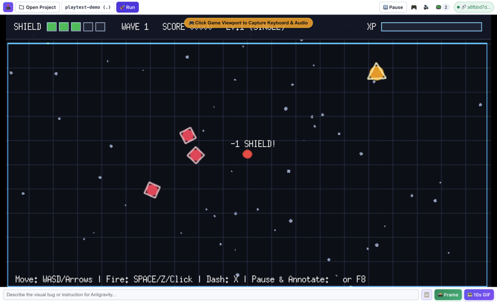
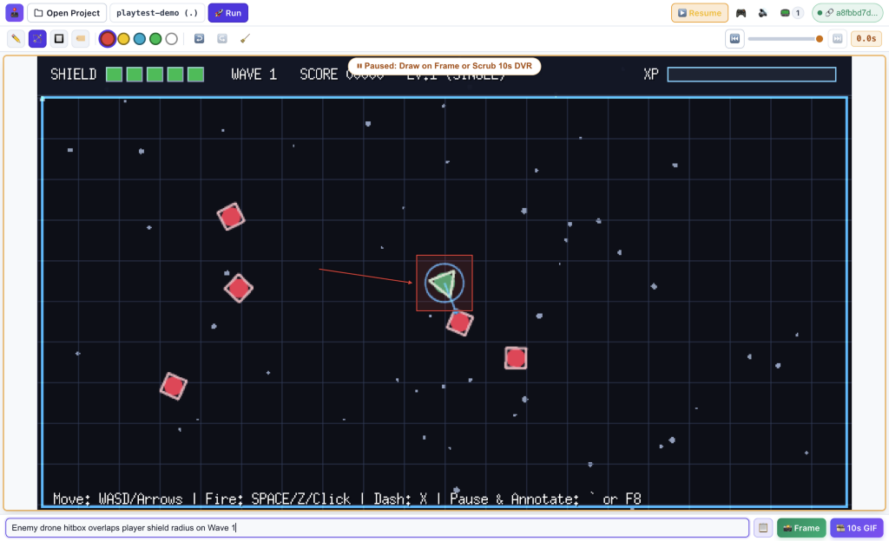
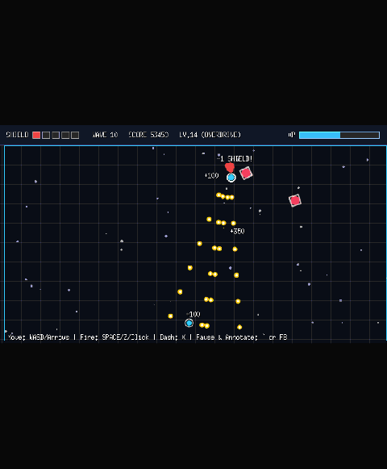
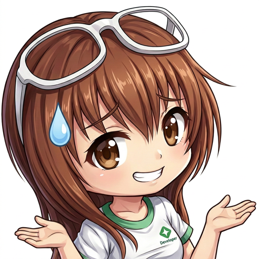

# Antigravity 2D Game Studio (`agy-game-studio`)

**Antigravity 2D Game Studio** is a 2D game development plugin for [Google Antigravity](https://antigravity.google), Go, and [Ebitengine](https://ebitengine.org/). Version `0.4.0` bundles **9 game-dev and media skills**, a **10-tool Go MCP server** (`game-studio`) with zero Python or `uv` runtime dependencies, and the **Game Dev Studio Playtest UI** (60 FPS WASM runner, 10s DVR rewind, visual bug annotation, and GIF capture).



---

## User-Level Installation

`agy-game-studio` ships with prebuilt UI assets (`dist/`) and uses Antigravity's bundled Node.js runtime and `sidecar_sdk`. Installing the plugin as a user requires **no `npm install`**, **no frontend build step**, and **no Python or `uv` installation**: you only need a Go toolchain (`1.26+` recommended) to compile Ebitengine games to WebAssembly (`GOOS=js GOARCH=wasm`) and build the bundled Go MCP server (`mcp/`) on demand.

### Optional Gemini and Vertex AI credentials

Procedural audio (`.music`, `.sfx`), procedural or `.aseprite` sprites, sprite normalization, and WASM playtesting work completely offline. To enable generative AI assets via **`image_generate`** (Nano Banana) and **`music_generate`** (Lyria) in the `game-studio` MCP tools, configure one of two Google Gen AI authentication modes:

- **Option 1: Vertex AI / Gemini Enterprise (Application Default Credentials)**:

  ```bash
  gcloud auth application-default login
  export GOOGLE_CLOUD_PROJECT="your-gcp-project-id"
  export GOOGLE_CLOUD_LOCATION="global"
  export GOOGLE_GENAI_USE_ENTERPRISE="true" # or GOOGLE_GENAI_USE_VERTEXAI="true"
  ```

- **Option 2: Gemini Developer API (API key)**:

  ```bash
  export GEMINI_API_KEY="your-api-key" # or GOOGLE_API_KEY
  ```

### 1. Install the plugin

Choose the installation method for your Antigravity surface:

#### Antigravity CLI (`agy`)

Install directly from GitHub in your shell:

```bash
agy plugin install https://github.com/danicat/agy-game-studio
```

Or inside an interactive `agy` TUI session using `/plugin`:

```text
/plugin install https://github.com/danicat/agy-game-studio
```

#### Antigravity 2.0 and Antigravity IDE

Place (or symlink) the plugin directory in one of Antigravity's plugin discovery roots:

- **Global (all workspaces)**:
  - **macOS / Linux**: `~/.gemini/config/plugins/agy-game-studio`
  - **Windows**: `%USERPROFILE%\.gemini\config\plugins\agy-game-studio`

  ```bash
  git clone https://github.com/danicat/agy-game-studio.git ~/.gemini/config/plugins/agy-game-studio
  ```

- **Symlinked local checkout (recommended for local development or testing)**:
  Clone anywhere and link your working tree into the global plugins folder so Antigravity loads edits directly from your checkout (see the [Developer & Contributor Guide](#developer--contributor-guide) below):

  ```bash
  ln -s /path/to/agy-game-studio ~/.gemini/config/plugins/agy-game-studio
  ```

- **Workspace (project-scoped)**:
  Place the plugin at `.agents/plugins/agy-game-studio` in your repository root, or declare its parent directory in `.agents/plugins.json` (workspace) or `~/.gemini/config/plugins.json` (global):

  ```json
  {
    "entries": [
      { "path": "/path/to/plugins" }
    ]
  }
  ```

### 2. Enable the plugin

1. If you created or symlinked a new plugin directory manually on disk, **restart Antigravity** so it discovers the directory on startup.
2. In **Antigravity 2.0** or **Antigravity IDE**, open **Customizations** in the left sidebar, select the **Installed** tab, and verify **Game Dev Studio** (`agy-game-studio`) is enabled. (Or run `/plugin` in chat / `agy plugin enable agy-game-studio` in the CLI.)
3. Once enabled, Antigravity automatically starts and supervises both the `agy-game-studio/studio` sidecar process and the `game-studio` stdio MCP server (`mcp_config.json`).

### 3. Open Game Dev Studio & verify your environment

Use `/game-dev-studio` inside any Antigravity conversation to open the **Game Dev Studio** side panel (`sidecar://agy-game-studio/studio/playtest`), or click **⋮ -> Extensions -> Game Dev Studio** in the top-right corner of a conversation:

- **Pick & Run a Go Project**: Click **Open Project** to select a Go module and runnable package, then click **🚀 Run** to compile (`GOOS=js GOARCH=wasm`) and playtest your Ebitengine game at 60 FPS.

Run `./scripts/check_env.sh` (or `./scripts/check_env.sh --help`) at any time to verify `go`, `wasm_exec.js`, `node`, optional `godoctor`/`kungfu`, and optional `gemini auth` configuration.

---

## Game Dev Studio Playtest Extension (`sidecars/studio`)

Open **Game Dev Studio** in the right-hand side pane via `/game-dev-studio`, `[Game Dev Studio](sidecar://agy-game-studio/studio/playtest)`, or **⋮ -> Extensions -> Game Dev Studio**.

- **One-click WASM compilation**: Click **Open Project** to select your Go game folder and main package (for example `/path/to/game` or `/path/to/repo/cmd/game`) and click **🚀 Run**. The sidecar resolves `go.mod`, builds with `GOOS=js GOARCH=wasm`, and streams compiler or runtime panic tracebacks straight to chat.
- **60 FPS Zero-Copy DVR Ring Buffer**: Continuously records the last **10 seconds (250 frames @ 25 FPS)** onto GPU-backed 2D canvases without dropping frame rate.
- **Pause, Scrub & Annotate (`F8` or `` ` ``)**: Pause gameplay, scrub frame-by-frame through the 10s DVR timeline, draw boxes/arrows/callouts over visual bugs, and send either:
  - **📸 Frame**: Smart-cropped PNG screenshot (true-to-screen resolution when unannotated, or automatically expanded to include margin notes) plus WASM console logs.
  - **🎞️ 10s GIF**: Pure 10-second animated GIF89a replay locked strictly to the game's screen resolution plus WASM console logs.



### Exported 10s DVR Gameplay GIF



---

## Bundled Skills (9 Skills)

All 9 game-dev and media skills ship inside `skills/` alongside their detailed `references/` guides. In v0.4.0, duplicate per-skill `scripts/` directories inside `skills/` were removed in favor of the single bundled Go MCP server (`mcp/`), eliminating any Python or `uv` runtime dependency.

| Skill | Domain | What it does |
| :--- | :--- | :--- |
| [`vibe-game-developer`](skills/vibe-game-developer/SKILL.md) | Workflow Router | Orchestrates 2D Go and Ebitengine game builds across all companion skills, the 10 Go MCP tools, and the Game Dev Studio Playtest panel. |
| [`game-design`](skills/game-design/SKILL.md) | Game Design | Runs a focused one-decision-at-a-time interview across any 2D genre and writes a structured `GDD.md`. |
| [`ebitengineer`](skills/ebitengineer/SKILL.md) | Go & Ebitengine | Guides modular `internal/` architecture, scene FSM, virtual resolution, zero-allocation `Draw()`, `//go:embed` asset loading, Kage shaders, and WASM builds. |
| [`sprite-design`](skills/sprite-design/SKILL.md) | 2D Sprites & Animation | Covers procedural `.sprite` DSL, binary `.aseprite` v1.3 containers, sheet normalization, palette extraction, and zero-allocation `AnimationController` playback. |
| [`procedural-sfx`](skills/procedural-sfx/SKILL.md) | Procedural SFX | Authors `.sfx` DSL sound cues compiled in memory to 4-byte aligned 44.1 kHz stereo PCM with 18 presets, PolyBLEP, SVF sweeps, and LFSR noise. |
| [`procedural-music`](skills/procedural-music/SKILL.md) | Procedural Music | Authors polyphonic `.music` DSL soundtracks compiled via pure-Go SEGA YM2612 + SN76489 or macOS CoreAudio (`gs_instruments.dls`). |
| [`nano-banana`](skills/nano-banana/SKILL.md) | AI Sprites & Art | Drives `image_generate` for character turnaround sheets, `4x4` chroma-key sprite grids, `4:1` parallax backgrounds, and multi-image edits. |
| [`lyria`](skills/lyria/SKILL.md) | AI Music & Songs | Drives `music_generate` (`lyria-3.5`, `lyria-3-clip-preview`, `lyria-3-pro-preview`) for 44.1 kHz stereo tracks, songs with lyrics, and image-to-music audio. |
| [`game-dev-studio`](skills/game-dev-studio/SKILL.md) | Studio Launcher | Surfaces `[Game Dev Studio](sidecar://agy-game-studio/studio/playtest)` pills in chat to launch the Playtest panel in the auxiliary pane. |

You can also pair external tools such as [`godoctor`](https://github.com/danicat/godoctor) for Go verification and linting alongside this plugin. Those optional tools live outside `skills/`.

---

## Baked-Asset Workflow (`//go:embed`) for Ebitengine Go Games

Whether you author procedural DSLs or generate art and music with Nano Banana and Lyria, games bake all assets into self-contained binaries. Go's standard `//go:embed` (`embed.FS`) handles this directly:

1. **Create or generate assets**: Author `.sprite`, `.music`, or `.sfx` files, generate character sheets and backgrounds with `image_generate`, and create soundtracks with `music_generate`.
2. **Normalize and bake game-ready files**:
   - **Sprites**: Run `sprite_normalize` or `sprite_compile` to bake packed `.png` sheets + `.json` manifests or `.aseprite` binaries into `internal/assets/`.
   - **Audio**: Run `sfx_synthesize`, `music_synthesize`, or `music_generate` to bake `.wav` or `.mp3` tracks into `internal/assets/`.
3. **Embed at compile time (`//go:embed`)**: Declare `//go:embed` patterns in `internal/assets/assets.go` so every sprite sheet, audio asset, font, and Kage shader compiles directly into the Go executable and WebAssembly bundle (`game.wasm`) with zero external file I/O or runtime API calls.
4. **Validate fail-fast at `Boot` and run at 60 FPS**: Decode and validate all embedded bytes once during `Boot` (returning explicit errors on malformed assets, enforcing 4-byte stereo PCM alignment `len(pcm) &^ 3` on `44.1 kHz` audio streams, and pre-slicing sprite frames once before entering `Update()` or `Draw()`), then launch in **Game Dev Studio** (`GOOS=js GOARCH=wasm`).

---

## Bundled MCP Server (`game-studio`, 10 Tools)

`mcp_config.json` exposes the unified headless Go engine server (`mcp/`) over stdio using `scripts/run-mcp.mjs`, providing 10 tools for Antigravity agents with zero Python or `uv` dependency:

| Tool | Purpose |
| :--- | :--- |
| `sound_presets` | Lists the 18 built-in SFX archetype presets, music wave types, YM2612 FM patches, and classical tempo markings. |
| `music_synthesize` | Synthesizes and analyzes a `.music` DSL score to 16-bit 44.1 kHz stereo WAV and optional per-track binary stems. |
| `music_validate` | Validates a `.music` DSL score against production BGM music theory, consonance, drift, channel count, and duration rules. |
| `sfx_synthesize` | Synthesizes and validates a `.sfx` DSL sound effect cue to 16-bit 44.1 kHz stereo WAV. |
| `sprite_inspect` | Inspects a `.sprite` container, binary `.aseprite`/`.ase` file, or `.png` sprite sheet and optionally exports a rendered PNG. |
| `sprite_compile` | Compiles a `.sprite` DSL spec and optionally writes packed `.png` sheets, `.aseprite` binaries, `.json` manifests, previews, and `.gif` previews. |
| `sprite_normalize` | Strips chroma-key backgrounds, centers and grounds frames, and exports normalized `.png`, `.json`, `.sprite`, `.aseprite`, and `.gif` outputs. |
| `sprite_extract_palette` | Extracts 4-step material shading ramps from a reference character sheet image as `.sprite` DSL `ramp` directives. |
| `image_generate` | Generates or edits images via Nano Banana models (`nano-banana-2.1`, `nano-banana-2`, `nano-banana-2-lite`, `nano-banana-pro`) across `interactions` and `models` API modes with optional Search grounding and up to 14 reference images. |
| `music_generate` | Generates 44.1 kHz stereo music and songs via Lyria models (`lyria-3.5`, `lyria-3-clip-preview`, `lyria-3-pro-preview`) across `interactions` and `models` API modes, writing `.mp3` or `.wav` audio and optional lyrics files. |

---

## Developer & Contributor Guide

Only contributors modifying Game Dev Studio's TypeScript frontend (`src/`), sidecar server (`server/`), bundled skills (`skills/`), or Go MCP server (`mcp/`) need to install dev dependencies or rebuild `dist/`.

### 1. Symlinked local plugin workflow

Clone the repository and symlink it into `~/.gemini/config/plugins/agy-game-studio` so Antigravity loads your live working tree directly without re-copying files after each edit:

```bash
git clone git@github.com:danicat/agy-game-studio.git
cd agy-game-studio
ln -s "$(pwd)" ~/.gemini/config/plugins/agy-game-studio
ls -la ~/.gemini/config/plugins/agy-game-studio
./scripts/check_env.sh
```

If `~/.gemini/config/plugins/agy-game-studio` already exists as a cloned directory, remove or back it up before creating the symlink, and restart Antigravity once so it picks up the symlinked path.

### 2. Build, typecheck, and test

```bash
npm install
npm run build
npm run typecheck
npm test
(cd mcp && go test ./...)
```

`npm run build` typechecks the TypeScript source (`src/`) and runs Vite to produce the self-contained frontend bundle (`dist/index.html`, `dist/app.js`, `dist/styles.css`) so the committed `dist/` folder runs with zero external `node_modules`.

### 3. Debugging & reloading through the symlink

Antigravity writes sidecar `stdout` and `stderr` to:

```text
~/.gemini/antigravity/sidecar_data/agy-game-studio/studio/logs/sidecar.log
```

- **Frontend changes (`src/`)**: Run `npm run build`, then refresh or close and reopen the Game Dev Studio panel. The sidecar server reads `dist/index.html`, `dist/app.js`, and `dist/styles.css` fresh from disk on every request.
- **Backend or MCP changes (`server/`, `sidecars/studio/`, or `mcp/`)**: Run `npm test` and `(cd mcp && go test ./...)`, then disable and re-enable **Game Dev Studio** (`agy-game-studio`) in **Customizations -> Installed** (or via `/plugin`). Re-enabling restarts the background sidecar and triggers `scripts/run-mcp.mjs` to recompile `mcp/` on demand if Go sources changed.
- **Skill changes (`skills/`)**: Edits to `SKILL.md` and `references/` under the symlinked repository take effect on subsequent agent turns (or after toggling the plugin).

---

## About the Author

DISCLAIMER: I AM NOT A GAME DEVELOPER.



I am [Daniela Petruzalek](https://linkedin.com/in/petruzalek), a Developer Relations Engineer at Google. I might not be a game developer, but I am a lifetime gamer and game collector. I enjoy using projects like this to teach software engineering, agentic coding, and creative ways to build with AI.

---

## Disclaimer

This is not an officially supported Google product.
