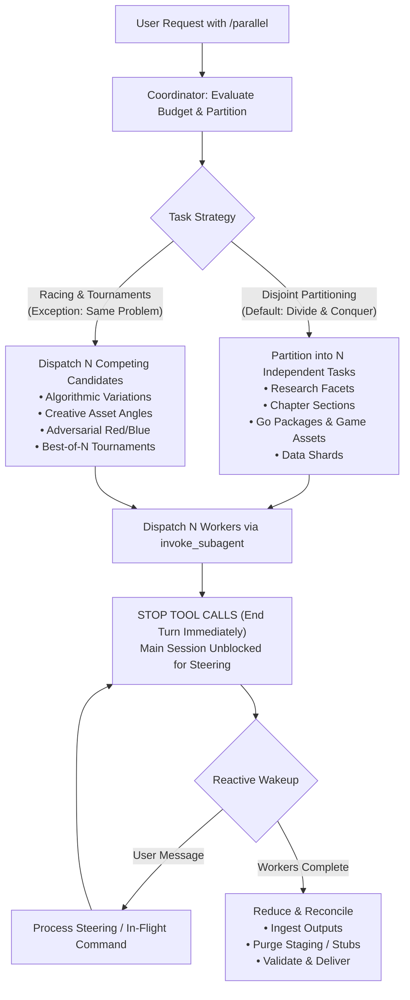

# Parallel: Task Concurrency and Agent Scaling Engine

`parallel` is a task parallelization and subagent scaling engine for Antigravity. It splits large goals across concurrent subagents according to an explicit **Degree of Parallelism (DOP)** budget, keeping each worker in a clean context window and finishing work faster.

`parallel` scales any type of work: research, long-form writing, technical analysis, planning, Go and Ebitengine coding, procedural asset and audio creation, code reviews, data processing, UI design, or side-by-side evaluations.

```
+-------------------------------------------------------------------------+
|                         PARALLEL TOPOLOGY                               |
|                                                                         |
|                          ROOT COORDINATOR                               |
|                 (Unblocked, Reactive, User-Facing)                      |
|                     /           |           \                           |
|                    v            v            v                          |
|             +------------+ +------------+ +------------+                |
|             |  Worker 1  | |  Worker 2  | |  Worker N  |                |
|             |  (Slice A) | |  (Slice B) | |  (Slice N) |                |
|             +------------+ +------------+ +------------+                |
|                    \            |            /                          |
|                     v           v           v                           |
|                        REDUCE & RECONCILE                               |
|               (Synthesize, Validate & Deliver to User)                  |
+-------------------------------------------------------------------------+
```

---

## Core Principles and Operational Rules

### 1. Activation Triggers and Syntax
Activate this skill whenever the user asks for parallel subagent execution or sets a concurrency budget:
- `/parallel <DOP>` (such as `/parallel 5` or `/parallel 12`)
- `/parallel dop: <number>` (such as `/parallel dop: 8`)
- `/parallel budget <number>` (such as `/parallel budget 4`)
- **Multi-phase budgets** (such as `"use /parallel 5 for planning and /parallel 10 for implementation"`, or `"phase 1: /parallel 3; phase 2: /parallel 6"`)
- **Natural language requests** (such as *"parallelize this research across 6 agents"*, *"run this task in parallel with a budget of 4"*, or *"swarm this audit with 8 workers"*)

### 2. Degree of Parallelism (DOP) and Budget Rules
- **Definition**: The **DOP** or **subagent budget** sets the maximum number of active subagents running at the same time.
- **Use the Full Budget**: Aim to use the full allocated budget whenever enough independent tasks exist so work finishes as fast as possible.
- **Minimum Subagent Rule**: Always use at least **1 subagent**. Even when `DOP = 1`, delegate the work to a subagent so the main chat session stays unblocked.
- **Default Budget**: If the user asks for parallel execution without giving a number, default to **5** workers (or **10** for large codebase tasks).
- **Slot Reuse**: As soon as a worker finishes or stops, its slot returns to the budget pool for the next queued task.

### 3. Hard Rule: Unblock the Main Session Right Away
The root agent running `/parallel` acts strictly as a **non-blocking Coordinator**:
- **Dispatch and Yield**: Define the task slices, launch workers with `invoke_subagent`, and **stop calling tools right away to end your turn**.
- **Always Responsive**: Never run polling loops, `sleep` commands, or blocking waits. Keep the main session free so the user can ask for status updates, change scope, or steer active workers at any time.
- **Coordinate, Do Not Execute**: Manage task decomposition, worker dispatch, and final synthesis. Do not write large code changes, run long scripts, or do heavy research directly in the root session.

### 4. Flat Topology by Default
- Use a flat structure (`Coordinator -> N Independent Workers`) by default.
- Flat teams avoid extra message hops and keep coordination simple.
- Use sub-leads only when the budget is very large (`DOP >= 20`) across multiple separate subsystems.

### 5. Independent, Non-Overlapping Work Units
Unless you are intentionally racing agents on the same problem, split tasks along clean, non-overlapping boundaries:
- Give each worker exclusive ownership of specific files, packages, assets, topic angles, or data chunks.
- **Single Writer Rule**: Only one subagent may write to any given file or resource. When workers need isolated repo trees, pass `Workspace: 'branch'` or `Workspace: 'share'` in `invoke_subagent`.
- **Two-Tier Staging Pattern**: When outputs merge into a single document or module, have workers write full output to isolated staging files (`staging/chunk_*.md`). Workers must keep their `send_message` completion reports under 2,000 characters with only status, output file paths, and key takeaways.

### 6. The Exception: Agent Racing and Tournaments
The one exception to non-overlapping tasks is **Agent Racing**:
- When exploring ambiguous architecture, solving hard algorithms, hunting subtle bugs, or comparing creative directions (such as multiple `.sprite`, `.music`, or `.sfx` variations), assign the same problem or distinct design constraints to `N` parallel subagents.
- Compare candidates side by side using Best-of-N selection, automated tests, or hybrid synthesis that combines the best parts of each runner.

### 7. Subagent Configuration Standards
- **Model Selection**: Set `Model: 'inherit'` in `define_subagent` and `invoke_subagent` calls unless the user explicitly asks for `flash`, `flash_lite`, `pro`, or a pinned CLI model.
- **Disposable Workers**: Keep workers task-scoped. Launch a fresh subagent with a clean context window for each new task instead of reusing old workers across unrelated jobs.

### 8. Vertical Messaging Only (No Sibling Crosstalk)
- **Allowed**: `Coordinator <-> Worker` communication.
- **Forbidden**: `Worker <-> Worker` communication. Workers run independently and report only to the Coordinator.
- **User Questions**: Subagents cannot call `ask_question`. If a worker hits an ambiguous requirement, it messages the Coordinator, and the Coordinator asks the user and relays the answer back.

---

## Domain Decomposition Matrix

`/parallel` scales across general software, research, writing, and game development workflows:



| Domain | Partitioning Dimension | Worker Assignment | Deliverable | Reduce Action |
| :--- | :--- | :--- | :--- | :--- |
| **Research** | Topic facet, search angle, competitor | Deep dive on 1 subtopic | Research memo with cited sources | Synthesize into master briefing |
| **Writing** | Chapter, section, viewpoint | Draft 1 self-contained section | Staged draft section | Unify voice, transitions, and table of contents |
| **Coding & Go** | Package, module, subsystem | Build 1 isolated package with `godoctor` / `ebitengineer` | Package code and unit tests | Wire packages together and run integration tests |
| **Game Assets & Audio** | Sprite, tileset, BGM track, SFX cue | Create 1 asset via `sprite-design`, `procedural-music`, `procedural-sfx`, or `lyria` | `.sprite`, `.music`, `.sfx`, or audio file | Register assets in loader and verify playback/rendering |
| **Review & QA** | Security, performance, style, allocation | Audit codebase from 1 perspective | Issue log with file and line references | Deduplicate into a prioritized fix list |
| **Data & ETL** | Date range, key partition, file batch | Transform and analyze 1 data shard | Cleaned shard and metrics | Combine metrics and write summary |
| **Strategy & Design** | Scenario, persona, user flow | Model 1 scenario or screen spec | Impact brief or layout spec | Build unified decision matrix or component set |

---

## Cross-Skill Integration for Engineering and Game Development

When scaling multi-agent execution alongside companion skills, pair `parallel` with the right domain workflow:

- **`swarm-coding` and `vibe-game-developer`**: `parallel` governs the concurrency budget (`DOP`), immediate turn yielding, slot queueing, and Best-of-N racing. `swarm-coding` and `vibe-game-developer` define the shared engineering contract (`SPECS.md`), architectural gates, and sprint slices that keep parallel workers aligned.
- **`ebitengineer` and `godoctor`**: Give each coding worker an exclusive Go package directory (such as `internal/physics`, `internal/combat`, or `internal/render`). Instruct workers to use `godoctor` for safe AST edits and package verification and `ebitengineer` for zero-allocation `Update`/`Draw` loops before reporting completion.
- **`sprite-design`, `procedural-music`, `procedural-sfx`, and `lyria`**: Asset pipelines parallelize cleanly because every visual or audio asset lives in its own file. Dispatch parallel workers to create `.sprite` sheets (`sprite-design`), `.music` tracker scores (`procedural-music`), `.sfx` sound effects (`procedural-sfx`), or AI music streams (`lyria`), or race 3 to 4 workers on alternative boss themes and character sprites for a Best-of-N tournament.

---

## Non-Blocking Coordinator Lifecycle

```
+--------------------------------------------------------------------------+
|                     COORDINATOR LIFECYCLE PROTOCOL                       |
|                                                                          |
|  1. Parse DOP & Mode (Single-Phase or Multi-Phase)                       |
|  2. Define Disjoint Scopes & Output Contracts                            |
|  3. Call invoke_subagent for each active worker                          |
|  4. Brief User: "Dispatched N parallel workers. Standing by..."          |
|  5. STOP CALLING TOOLS (Turn ends right away)                            |
|                                                                          |
|     ... Main session stays interactive ...                               |
|     - User asks status: Coordinator calls manage_subagents(Action="list")|
|     - User steers: Coordinator calls send_message or kills workers       |
|     - Workers finish: Messaging system wakes Coordinator automatically   |
|                                                                          |
|  6. Run Reduce Phase & Deliver Verified Output to User                   |
+--------------------------------------------------------------------------+
```

---

## Multi-Phase Parallel Orchestration

When the user sets budgets for multiple stages in one prompt (such as *"use /parallel 4 for planning and /parallel 10 for implementation"*):

```
PHASE 1: Planning (DOP = 4)
Coordinator dispatches 4 planning workers -> YIELDS TURN IMMEDIATELY
All 4 workers finish -> Reactive wakeup
      |
      v
PHASE 1 REDUCE & BARRIER
Coordinator compiles unified specification (specs/plan.md)
(Optional human checkpoint / review)
      |
      v
PHASE 2: Implementation (DOP = 10)
Coordinator dispatches 10 implementation workers referencing specs/plan.md -> YIELDS TURN IMMEDIATELY
All 10 workers finish -> Reactive wakeup
      |
      v
FINAL REDUCE & DELIVERY
Coordinator integrates deliverables, runs verification, and presents result
```

See [`references/multi_phase_orchestration.md`](references/multi_phase_orchestration.md) for the full state machine and document handoff rules.

---

## Agent Racing and Tournaments

While non-overlapping task slicing is the default, **Racing** assigns multiple workers to the same problem to explore different solutions:

1. **Identical Prompt Racing**: Run `N` workers with the same prompt to explore diverse solutions for hard bugs or creative assets.
2. **Constrained Angle Racing**: Give `N` workers different design priorities (such as low latency vs. low memory vs. simple code, or 3 distinct art/music styles).
3. **Adversarial Red-Blue Racing**: Pair builder workers against breaker/auditor workers to uncover edge cases and vulnerabilities.
4. **Best-of-N Tournaments**: Collect `N` candidate solutions, score them with tests or rubrics, and pick the winner or merge the best parts.

See [`references/racing_and_tournaments.md`](references/racing_and_tournaments.md) for tournament brackets and scoring templates.

---

## The Reduce (Reconciliation) Pipeline

Before finishing, the Coordinator runs the **Reduce** phase to unify worker outputs:

1. **Completeness Check**: Confirm all `N` workers wrote their deliverables to disk with no leftover placeholders (`TODO`, `FIXME`, or temporary stubs).
2. **Assembly**:
   - Merge staged Markdown sections into the final document.
   - Wire Go packages, game systems, and generated `.sprite`, `.music`, and `.sfx` assets into the main entry point.
   - Combine data shards into unified tables.
3. **Verification**:
   - Run builds, tests, or linters (such as `go test ./...` or `godoctor` checks).
   - Check links, citations, and asset load paths.
4. **Delivery Summary**: Present the final result along with a brief summary of workers run, tasks finished, and key trade-offs resolved.

---

## Common Pitfalls to Avoid

1. **Blocking the Main Session**: Never run `sleep` loops or poll subagent status. End your turn immediately after calling `invoke_subagent`.
2. **Doing Worker Tasks in the Coordinator**: Do not write production code or perform deep search sweeps in the root agent. Delegate execution to workers.
3. **Sibling Crosstalk**: Never tell workers to message each other. All communication flows vertically between the Coordinator and each worker.
4. **Reusing Context-Heavy Workers**: Do not reuse an old subagent for an unrelated task. Launch a fresh worker so its context stays small and focused.
5. **Write Collisions**: Never let two workers edit the same file at the same time. Enforce exclusive file ownership, staging directories, or isolated workspaces (`branch` / `share`).
6. **Skipping the Reduce Step**: Never leave unmerged staging files or mock stubs behind. Always integrate and verify deliverables before reporting completion.
7. **Under-Using the Budget**: When enough independent tasks exist, launch the full number of workers requested by the user's DOP budget.

---

## Reference Guides

- **Task Decomposition Guide**: [`references/task_decomposition.md`](references/task_decomposition.md) covers partitioning strategies, domain matrices, staging directories, and file ownership rules.
- **Racing and Tournaments Guide**: [`references/racing_and_tournaments.md`](references/racing_and_tournaments.md) covers identical races, constrained angle races, adversarial audits, and Best-of-N selection.
- **Multi-Phase Orchestration Guide**: [`references/multi_phase_orchestration.md`](references/multi_phase_orchestration.md) covers multi-stage pipelines, barrier synchronization, document handoffs, and live steering.
- **Coordinator Playbook**: [`references/coordinator_playbook.md`](references/coordinator_playbook.md) covers budget parsing, `invoke_subagent` dispatch patterns, reactive wakeups, and final verification.

---

## Pinning Exact Models and Reasoning Effort in Antigravity

> **Environment Note**: Use the `agy` CLI only when running inside Google Antigravity. In other agent hosts, use that environment's native subagent tool instead.

In Antigravity, `invoke_subagent` supports coarse model tiers (`inherit`, `pro`, `flash`, and `flash_lite`) and does not pin an exact model version or reasoning effort level. When the user requests a specific model ID (such as `gemini-4-argon` or `gemini-3.8-flash`) or an explicit reasoning effort level (`low`, `medium`, `high`, `xhigh`, or `max`), launch each worker as a headless `agy` CLI background process instead of calling `invoke_subagent`:

1. **List available model IDs**:
   Run `agy models` to see valid model IDs and effort variants (such as `gemini-4-argon-high`, `gemini-4-argon-medium`, `gemini-3.8-flash-high`, or `gemini-3.8-flash-low`).

2. **Start non-blocking background workers**:
   Launch each worker in the background using `run_command` with `WaitMsBeforeAsync: 500`, writing outputs to isolated staging files. Pass the prompt inline with `-p="..."`:
   ```bash
   agy --model gemini-3.8-flash \
     --effort low \
     --mode auto \
     --disable-slash-commands \
     -p="You are Worker 1. <task instructions>. Write your output to staging/worker-01.md."
   ```
   You can pass `--model <base-id> --effort <low|medium|high|xhigh|max>` or pass a combined ID such as `--model gemini-3.8-flash-low`.

3. **End your turn right away**:
   Stop calling tools as soon as all `N` background `agy` commands start. Antigravity wakes the Coordinator when each background command finishes, and the Coordinator then runs the Reduce phase over the staged outputs.
