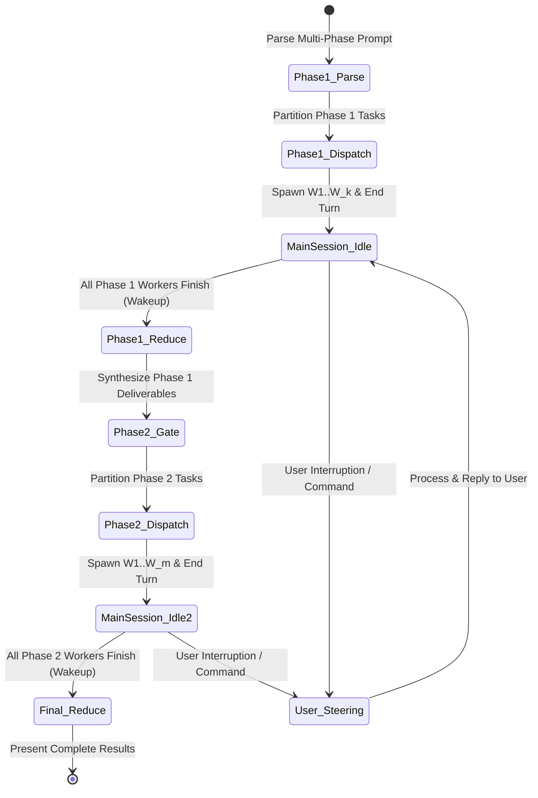

# Multi-Phase Parallel Orchestration Guide

This guide explains how to plan, run, and steer **multi-phase parallel budgets** requested in a single prompt (such as *"use /parallel 5 for planning and /parallel 10 for implementation"*).

---

## 1. Multi-Phase Syntax and Concept

Different stages of a project often need different levels of concurrency. Early discovery and architecture stages work well with 3 to 5 workers, while implementation, asset creation, and verification stages can fan out across 8 to 15 workers.

### Common Multi-Phase Prompts:
```
# Two-phase engineering pipeline
/parallel 4 for architecture and /parallel 10 for implementation

# Three-phase game development pipeline
Phase 1: /parallel 3 (specs & architecture); Phase 2: /parallel 8 (packages, sprites, music, sfx); Phase 3: /parallel 3 (integration & QA)

# Three-phase publishing pipeline
Phase 1: /parallel 3 (research); Phase 2: /parallel 6 (drafting); Phase 3: /parallel 2 (editing)
```

```
+-------------------------------------------------------------------------+
|                  MULTI-PHASE BARRIER SYNCHRONIZATION                    |
|                                                                         |
|  [PHASE 1: Planning]   Budget: 5 Workers                                |
|  Coordinator dispatches W1..W5 ===> YIELDS MAIN SESSION IMMEDIATELY     |
|  W1..W5 complete ===> Reactive wakeup of Coordinator                    |
|                                                                         |
|                       === PHASE 1 REDUCE BARRIER ===                    |
|                       Coordinator writes unified spec                   |
|                       (Optional Human Gate / Review)                    |
|                                                                         |
|  [PHASE 2: Execution]  Budget: 10 Workers                               |
|  Coordinator dispatches W1..W10 ===> YIELDS MAIN SESSION IMMEDIATELY    |
|  W1..W10 complete ===> Reactive wakeup of Coordinator                   |
|                                                                         |
|                       === FINAL REDUCE & DELIVERY ===                   |
+-------------------------------------------------------------------------+
```

---

## 2. The Non-Blocking Phase State Machine

To keep the main session responsive throughout a multi-stage workflow, the Coordinator yields at the end of every phase dispatch and wakes reactively as workers report back.



### Phase Rules:
1. **Dispatch and Yield Every Phase**: At the start of each phase, launch that phase's subagents and stop calling tools right away.
2. **Barrier Synchronization**: Do not start Phase `K + 1` until all Phase `K` workers finish and the Coordinator consolidates their outputs into a shared spec on disk.
3. **No Busy-Wait Polling**: Never run `sleep` loops between phases; let incoming worker messages trigger the transition.
4. **Live Steering**: If the user messages during Phase 1, handle their request right away without losing track of the remaining phases.

---

## 3. Document-First State Handoffs Between Phases

Never paste raw chat logs or long tool histories from Phase `K` into Phase `K + 1` prompts.

### How to Hand Off State Cleanly:
1. **Write a Consolidated Contract**: When Phase 1 finishes, write a clean specification file to disk (such as `SPECS.md`, `specs/implementation_plan.md`, or `briefs/master_research_brief.md`).
2. **Launch Fresh Workers**: Start Phase 2 with fresh subagents whose prompts point directly to that specification file on disk.
3. **Why This Works**:
   - Phase 2 workers start with clean context windows free of Phase 1 dead ends.
   - Every Phase 2 worker reads the exact same data structures, interface signatures, and asset registries.

---

## 4. Multi-Phase Pipeline Patterns

### Pattern A: Spec -> Build & Assets -> Verify (Game & Software Pipeline)
Works seamlessly with `swarm-coding`, `vibe-game-developer`, `ebitengineer`, `godoctor`, `sprite-design`, `procedural-music`, `procedural-sfx`, and `lyria`:
- **Phase 1: Architecture and Specs (`DOP = 3`)**:
  - Worker 1: Core state machine, entity interfaces, and package layout (`ebitengineer`).
  - Worker 2: Visual style guide, palette ramps, and sprite manifest (`sprite-design`).
  - Worker 3: Audio cue sheet, key/tempo map, and SFX triggers (`procedural-music`, `procedural-sfx`, `lyria`).
  - *Barrier*: Coordinator compiles everything into `SPECS.md`.
- **Phase 2: Parallel Implementation (`DOP = 8`)**:
  - Workers 1 to 4: Implement disjoint Go packages (`internal/engine`, `internal/physics`, `internal/combat`, `internal/ui`) using `godoctor` and `ebitengineer`.
  - Workers 5 to 6: Author character and tileset `.sprite` files using `sprite-design`.
  - Worker 7: Compose `.music` BGM tracks or `lyria` streams.
  - Worker 8: Synthesize `.sfx` cues using `procedural-sfx`.
  - *Barrier*: Coordinator wires packages and assets into `cmd/game/main.go`.
- **Phase 3: Verification and Playtest QA (`DOP = 2`)**:
  - Worker 1: Run `go test -race ./...` and `godoctor` static checks across all packages.
  - Worker 2: Audit hot-loop allocations, audio 4-byte PCM alignment, and sprite animation states.
  - *Final Reduce*: Deliver verified build to the user.

### Pattern B: Research -> Draft -> Review (Content Pipeline)
- **Phase 1: Research (`DOP = 4`)**:
  - Investigate 4 distinct topic angles and save 4 research memos in `staging/`.
  - *Barrier*: Coordinator writes a unified outline.
- **Phase 2: Drafting (`DOP = 6`)**:
  - Draft 6 sections in parallel into `staging/section_*.md`.
  - *Barrier*: Coordinator assembles the full draft.
- **Phase 3: Editorial Review (`DOP = 3`)**:
  - Worker 1: Technical accuracy and citation check.
  - Worker 2: Readability, jargon, and AI-slop audit.
  - Worker 3: SEO metadata and structure check.
  - *Final Reduce*: Present the reviewed draft and recommendations.

---

## 5. Handling Mid-Flight User Changes

Because the Coordinator stays unblocked, the user can adjust the pipeline at any point:

1. **Skip Ahead**: User says *"Stop planning and start building with approach X right now."*
   - Call `manage_subagents(Action="kill", ConversationIds=[...])` to stop active Phase 1 workers.
   - Write the spec using approach X and launch Phase 2 workers right away.
2. **Change Next Phase Budget**: User says *"Bump the Phase 2 budget from 8 to 12."*
   - Update your stored Phase 2 budget and let Phase 1 finish normally.
3. **Add a Requirement**: User adds a new feature or constraint during Phase 1.
   - Include the new requirement in the Phase 1 spec document at the barrier so all Phase 2 workers pick it up automatically.
