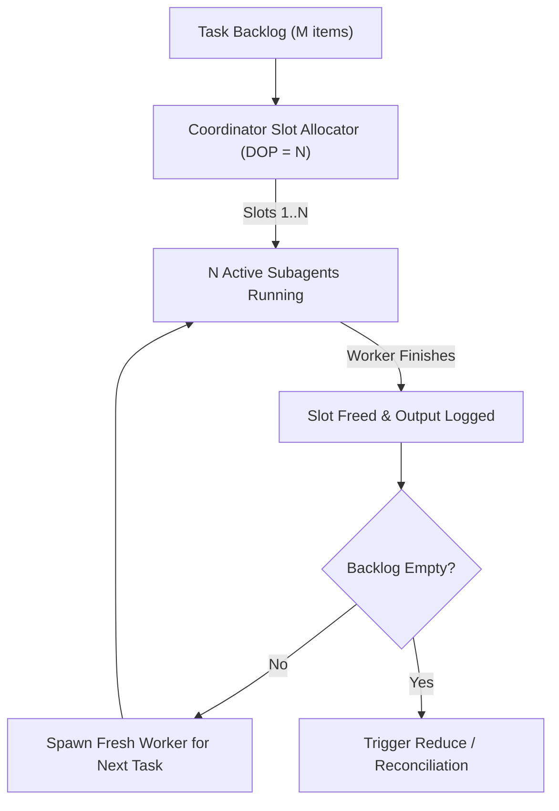

# Task Decomposition and Disjoint Partitioning Guide

This guide explains how to break any large goal into independent, non-overlapping work units for concurrent subagents under `/parallel`.

---

## 1. Core Rule: Keep Worker Boundaries Separate

Parallel speed depends on task independence. When subagents edit the same files or wait on each other's in-progress state, file conflicts undo the benefits of running in parallel.

```
+-------------------------------------------------------------+
|                     ROOT COORDINATOR                        |
|   - Analyzes goal & calculates DOP budget                   |
|   - Defines strict non-overlapping file/module boundaries   |
|   - Dispatches workers & yields main session immediately    |
+-------------------------------------------------------------+
         |                       |                     |
         v                       v                     v
+-----------------+     +-----------------+   +-----------------+
| Worker 1        |     | Worker 2        |   | Worker 3        |
| Scope: Slice A  |     | Scope: Slice B  |   | Scope: Slice C  |
| Output: Out_A   |     | Output: Out_B   |   | Output: Out_C   |
+-----------------+     +-----------------+   +-----------------+
         |                       |                     |
         +-----------------------+---------------------+
                                 |
                                 v
+-------------------------------------------------------------+
|                     REDUCE PIPELINE                         |
|   - Gathers disjoint outputs Out_A, Out_B, Out_C            |
|   - Verifies integrity & wires dependencies                 |
|   - Delivers synthesized final result to user               |
+-------------------------------------------------------------+
```

### Four Partitioning Rules
1. **Separate Scopes**: Give each worker its own set of target files, Go packages, game assets, topic facets, or data shards.
2. **Single Writer Principle**: Only one subagent may write to any specific file path.
3. **Staging Directories for Shared Targets**: When several workers contribute parts of a single document or module, have each worker write to `staging/task_<id>.md` and merge those files during the Reduce step.
4. **Fresh Context Windows**: Launch a new subagent for each task so every worker starts with a clean, focused context window.

---

## 2. Domain Decomposition Matrix

| Domain | Partitioning Dimension | Worker Assignment | Output Deliverable | Reduce Action |
| :--- | :--- | :--- | :--- | :--- |
| **Research & Discovery** | Topic facet, search angle, source type, or competitor | Focused investigation of 1 facet | Markdown memo (`staging/research_<facet>.md`) with citations | Synthesize findings, resolve conflicts, and write master brief |
| **Long-Form Writing** | Chapter, section, viewpoint, or case study | Draft 1 self-contained section from shared outline | Draft file (`staging/draft_sec_<N>.md`) | Harmonize voice, smooth transitions, and assemble final document |
| **Go & Ebitengine Code** | Package, subsystem, or screen state (`ebitengineer`, `godoctor`) | Implement 1 isolated package against `SPECS.md` | Package `.go` files and `_test.go` unit tests | Wire packages in `main.go`, remove stubs, and run `go test ./...` |
| **2D Sprites & Visuals** | Character sheet, tileset, UI icon set (`sprite-design`) | Create 1 `.sprite` asset or animation set | `assets/sprites/<name>.sprite` and exported sheets | Register sprites in asset loader and verify frame animations |
| **Game Music & SFX** | BGM track or SFX group (`procedural-music`, `procedural-sfx`, `lyria`) | Compose 1 `.music` track, `lyria` stream, or `.sfx` cue batch | `assets/audio/<name>.music` or `.sfx` files | Wire audio cues into sound manager and verify 4-byte aligned PCM playback |
| **Code Review & Audits** | Review lens: Security, Performance, Allocations, Style | Audit codebase from 1 perspective | Issue log (`staging/audit_<lens>.md`) with file and line numbers | Deduplicate and sort findings by severity |
| **Data Processing & ETL** | Data shard, key range, date window, or file batch | Transform and analyze 1 data shard | Cleaned shard and summary metrics | Aggregate metrics and produce final report |

---

## 3. Four Practical Slicing Patterns

### Pattern A: Facet or Lens Slicing
Split an analysis or audit by perspectives that do not overlap.
- **Example**: Auditing an Ebitengine game across 4 parallel workers:
  - Worker 1: Zero-allocation hot-loop check in `Update` and `Draw` (`ebitengineer`).
  - Worker 2: Go package structure, error handling, and concurrency safety (`godoctor`).
  - Worker 3: Visual contrast, silhouette readability, and animation timing (`sprite-design`).
  - Worker 4: Audio clipping, LUFS balance, and 4-byte stereo alignment (`procedural-music`, `procedural-sfx`).

### Pattern B: Chunk or Batch Slicing
Split a list of uniform items into even batches.
- **Formula**: For `M` items and budget `DOP = N`, assign Worker `i` roughly `M / N` contiguous items.
- **Example**: Creating 12 sound effects with `DOP = 3` (`procedural-sfx`):
  - Worker 1: Player movement and jump cues (`jump.sfx`, `dash.sfx`, `land.sfx`, `step.sfx`).
  - Worker 2: Combat cues (`slash.sfx`, `hit.sfx`, `parry.sfx`, `blast.sfx`).
  - Worker 3: UI and pickup cues (`coin.sfx`, `levelup.sfx`, `menu_move.sfx`, `menu_select.sfx`).

### Pattern C: Contract-First Package Slicing (`SPECS.md`)
When packages depend on shared types (as in `swarm-coding` and `vibe-game-developer`), define the contract before launching parallel coding workers:
1. Coordinator writes `SPECS.md` (or a small shared `internal/types` package) defining structs and interfaces.
2. Worker 1 builds `internal/physics` importing `internal/types`.
3. Worker 2 builds `internal/ai` importing `internal/types`.
4. Worker 3 builds `internal/render` importing `internal/types`.
5. Reduce step wires `physics`, `ai`, and `render` together in `internal/game` and runs `go test ./...`.

### Pattern D: Persona or Reader Slicing
When testing docs, tutorials, or UX flows:
- Worker 1: First-time user persona (checks onboarding friction and missing steps).
- Worker 2: Systems engineer persona (checks architecture depth, failure modes, and benchmarks).
- Worker 3: Copyeditor persona (checks readability, jargon, and tone).

---

## 4. File Ownership Rules

To prevent workers from overwriting each other's changes:

### 1. Explicit File Paths in Every Prompt
Tell each worker the exact files or directories it is allowed to create or edit:
```
# Good: Separate paths per worker
Worker 1: writes only to internal/physics/
Worker 2: writes only to internal/combat/
Worker 3: writes only to assets/sprites/hero.sprite

# Bad: Multiple workers editing the same file
Workers 1, 2, and 3 all edit main.go at the same time  <-- FORBIDDEN
```

### 2. The Staging Directory Pattern
When workers produce sections of a single target file:
1. Have each worker write to `staging/chunk_<worker_id>.md`.
2. During the Reduce phase, the Coordinator reads all `staging/chunk_*.md` files, merges them into the target file, and deletes the temporary `staging/` directory.

---

## 5. Queueing When Tasks Exceed Budget (`Tasks > DOP`)

When you have `M` independent tasks and a smaller concurrency budget `N` (`M > N`):



### Queue Rules:
1. **Fill All Slots Initially**: Launch `N` workers right away to match the user's DOP budget and end your turn.
2. **Refill Reactively**: Each time a worker finishes and wakes the Coordinator, launch a fresh worker for the next task in the backlog and end your turn again.
3. **Never Reuse Old Workers for New Slices**: Always spawn a fresh subagent for the next queued item so its context stays clean.

---

## 6. Reduce Phase Checklist

Before presenting the final result to the user, verify every item below:
- [ ] All `N` worker outputs exist on disk and match their assigned scopes.
- [ ] Zero `TODO`, `FIXME`, or temporary mock stubs remain in production files.
- [ ] Cross-package imports, asset paths, or document links resolve cleanly.
- [ ] Verification checks pass (`go test ./...`, `godoctor`, or asset lint checks).
- [ ] Temporary `staging/` files have been merged and cleaned up.
