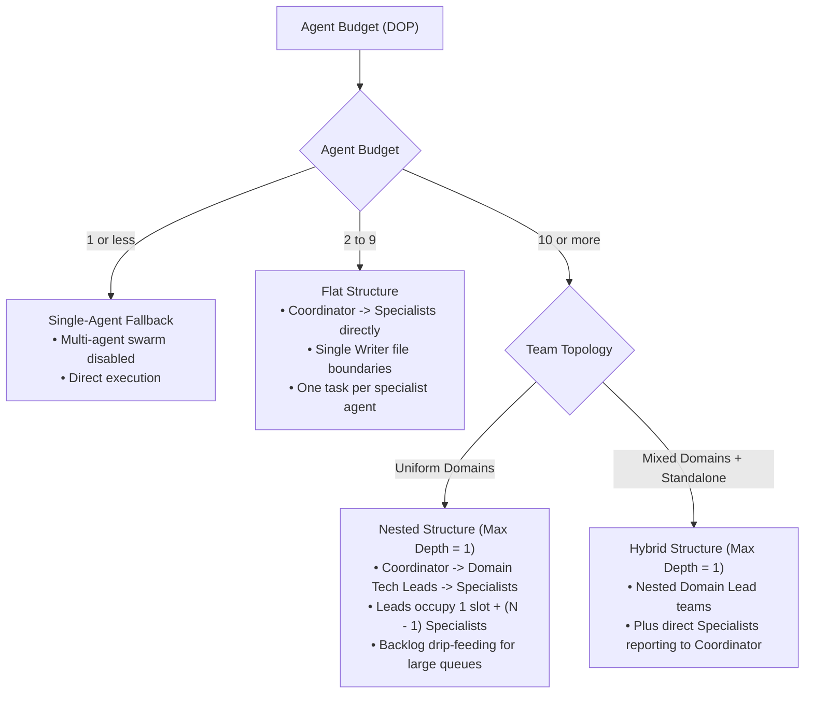
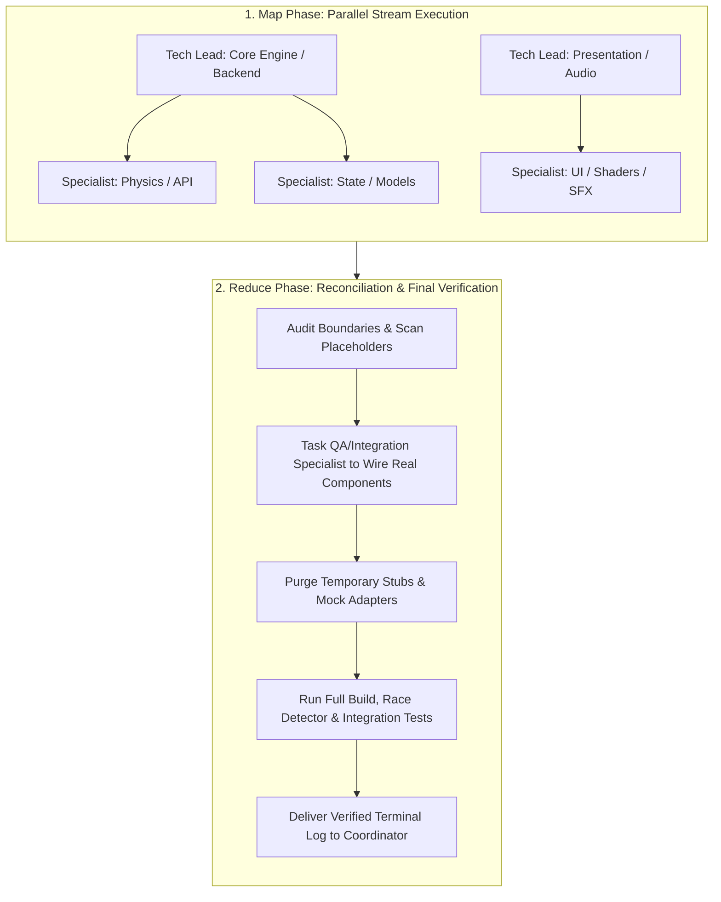
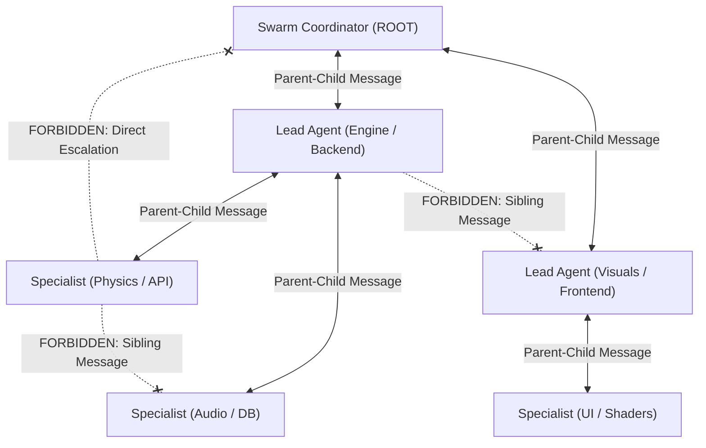

# Swarm Coding

Swarm Coding splits large engineering goals across specialized subagents organized in a clear team hierarchy. Each subagent works in an isolated context with exclusive file ownership, preventing write collisions and cross-domain bugs.

> [!NOTE]
> In this guide, the terms "agent" and "subagent" mean the same thing.

---

## Core Principles and Rules

### 1. Invocation Syntax and Budget Parsing
Read the user's prompt to find the target **Agent Budget / Degree of Parallelism (`DOP`)**:
- `swarm-coding(N)` or `/swarm-coding(N)` (for example, `swarm-coding(8)` or `/swarm-coding(12)`)
- `/swarm-coding <DOP>` or `/swarm <DOP>` (for example, `/swarm-coding 10` or `/swarm 6`)
- `/swarm-coding dop: <number>` or `/swarm-coding budget <number>` (for example, `/swarm-coding dop: 8`)
- **Natural language budgets** (for example, *"swarm this refactor across 8 agents"* or *"run a coding swarm with a budget of 12"*)
- If no number is given, default to **10**. If `DOP <= 1`, run directly as a single agent without spawning subagents.

### 2. Coordinator and Lead Non-Execution
- The ROOT Swarm Coordinator and Domain Lead Agents always stay in their planning and coordination roles. They never drop down to write production code themselves.
- Both Coordinator and Lead Agents are forbidden from editing production source files, running tests or builds, or calling `run_command`.
- Lead Agents have `EnableWriteTools: true` **only** to write or update markdown specification files (such as `docs/domain-spec.md`). Writing source code or running terminal commands in a Lead Agent breaks the swarm protocol.

### 3. Three Swarm Roles
- **Swarm Coordinator (ROOT):** The single root agent that activated the skill. It designs the **Org Chart**, names Lead Agents, splits the agent budget, writes top-level architecture specs, and runs the final Reduce phase.
- **Lead Agent (Domain Tech Lead):** One lead per technical domain (such as Engine/Physics, UI/Frontend, Audio/Assets, or Backend/DB). As its mandatory Step 1, it loads the `swarm-coding` skill, writes domain specs in `docs/`, spawns Specialists within its budget slice, and verifies domain deliverables.
- **Specialist:** A disposable, task-scoped worker. It implements a narrow set of files within one domain, runs package-scoped tests, and reports terminal output back to its parent Lead Agent.

### 4. Single Writer Principle and Staging Pattern
- **Single Writer Principle:** Only one Specialist has permission to create or edit a given file at any time. Disjoint file lists prevent concurrent write collisions.
- **Staging Pattern:** When multiple workers need to contribute to a shared contract, asset manifest, or registry, each worker writes to an isolated staging file (`staging/chunk_*.md` or a scoped file). The Lead Agent or Integration Specialist merges them during the Reduce phase.

### 5. Strict Vertical Communication (No Lateral Crosstalk)
- **Allowed:** Messages between direct parents and children only (`Swarm Coordinator <-> Lead Agent`, `Lead Agent <-> Specialist`, or `Swarm Coordinator <-> Specialist` in flat/hybrid mode).
- **Forbidden:** Direct messages between peers on the same level (`Lead <-> Lead` or `Specialist <-> Specialist`) or skipping a level (`Specialist <-> Swarm Coordinator` when working under a Lead Agent).
- **Design Document First:** Handle cross-domain changes by updating the shared specification in `docs/` first, then notifying parent or child agents with `send_message`.

### 6. Package-Scoped Testing (No Broad Root Sweeps)
Specialists must run fine-grained unit tests scoped strictly to their assigned package (for example, `go test ./internal/physics/...`). Running whole-repository test suites (such as `go test ./...` or `npm test` at the project root) is forbidden for Specialists during the Map phase because concurrent edits in other packages cause false failures. Full-project builds and test suites run only during the final Reduce phase.

### 7. Mandatory Skill Onboarding (Zero Ambient Knowledge)
- Subagents start with an empty context window. They do not automatically know `swarm-coding` rules, budget math, non-execution rules, or how to call `define_subagent` and `invoke_subagent`.
- Simply telling a subagent *"you are a swarm lead with a budget of 8"* without onboarding causes the Lead Agent to write code itself instead of spawning a team.
- **Coordinator -> Lead Onboarding:**
  1. Define Lead Agents with `EnableSubagentTools: true`, `EnableWriteTools: true`, and `EnableMCPTools: true`.
  2. Mandate **Step 1 (Load Skill)**: Instruct the Lead Agent to read `SKILL.md` and `references/lead.md` before doing anything else.
  3. Include the exact `define_subagent` and `invoke_subagent` schemas and budget math (`1 slot for Lead + (DOP - 1) concurrent Specialists`) in the Lead's prompt.
- **Lead -> Specialist Onboarding:** Configure Specialists with `EnableWriteTools: true` and `EnableSubagentTools: false`. Give each Specialist an explicit list of allowed files, forbidden files, package-scoped test commands, fail-fast rules, and instructions to send terminal logs via `send_message` before exiting.

---

## Agent Budget and Degree of Parallelism (DOP)

* **Definition**: **Agent Budget** (or **DOP**) is the maximum number of **active, concurrent subagents** running at the same time across the entire swarm.
* **Budget Math and Slot Accounting**:
  - `Domain Budget (DOP) = 1 (Lead Agent) + (DOP - 1) (Concurrent Specialists)`.
  - Every active Lead Agent uses 1 concurrency slot. If a Lead Agent receives a budget slice of 8, it uses 1 slot and can run up to **7 Specialists** at the same time.
* **Slot Recycling**: Finished subagents do not use budget. As soon as a Specialist sends its report and exits, its slot returns to the domain pool.
* **Backlog Drip-Feeding**: When a domain has more tasks than specialist slots (`DOP - 1`), the Lead Agent keeps a backlog and launches a new Specialist each time an active Specialist finishes.
* **Default Budget**: Defaults to **10** concurrent agents when not specified.
* **Low Budget Guard (<= 1):** If the budget is `<= 1`, skip subagent spawning and run directly as a single agent. Notify the user: *"Agent budget is set to <= 1; running in direct single-agent execution mode. To enable swarm parallelism, specify an agent budget > 1 (default: 10)."*

### Swarm Sizing Decision Tree



#### Sizing Rules:

1. **Agent Budget < 10 -> Flat Structure**:
   - The Coordinator manages Specialists directly without intermediate Lead Agents.
   - Split work with strict Single Writer file boundaries and assign one task per Specialist.
2. **Agent Budget >= 10 -> Nested Structure (Max Depth = 1)**:
   - Assign one Domain Tech Lead per domain and give each a slice of the budget (**each Lead counts as 1 slot**).
   - **Maximum Nesting Depth is strictly 1** (`Coordinator -> Domain Tech Leads -> Specialists`). Never create Sub-Leads or deeper layers. For large budgets (20+), Leads manage wider Specialist pools and drip-feed tasks from their backlog.
3. **Hybrid Structure (Mixed Workloads)**:
   - Combine nested domain teams (`Coordinator -> Domain Lead -> Specialists`) with direct Specialists (`Coordinator -> Specialist`) for standalone tasks or the final Integration/QA Specialist.

---

## Non-Blocking Coordinator and Reactive Concurrency

The Swarm Coordinator is the user's main point of contact and top-level conductor. It must stay **unblocked at least 99% of the time** so it can respond immediately to user steering, scope changes, and status checks.

1. **Delegation Over Execution:**
   - The Coordinator breaks down objectives, writes top-level contracts in `docs/`, and manages the org chart. It never blocks itself by writing production code, running builds, or running tests.
2. **Fire-and-Yield Concurrency:**
   - After launching Lead Agents (or Specialists in flat mode) with `invoke_subagent`, the Coordinator **immediately stops calling tools to end its turn**. Never loop, sleep, or poll.
3. **Always Ready for User Steering:**
   - Because the Coordinator yields right away, it stays responsive while the swarm runs in the background:
     - **Status Checks**: Inspect active workers with `manage_subagents (Action="list")` when the user asks for status.
     - **In-Flight Steering**: Forward new user instructions to active Lead Agents via `send_message`, or stop obsolete workers via `manage_subagents (Action="kill")`.
4. **Sole User Question Handler:**
   - Subagents do not have the `ask_question` tool. Specialists send questions to their Lead Agent, who forwards them to the Coordinator via `send_message`. The Coordinator asks the user with `ask_question` and relays the answer back down.

---

## Map-Reduce Workflow and Final Reconciliation

Swarm Coding runs as a two-stage **Map-Reduce** pipeline:



### 1. Map Phase (Parallel Development and Collision Avoidance)
* **Single Writer File Ownership**: Give every Specialist an exclusive list of files they may create or edit.
* **Staging Pattern**: When multiple workers produce items for a shared registry or configuration, have them write to isolated files in `staging/` for later merge.
* **Interface Contracts First**: When Specialist A depends on code being written by Specialist B, both code against the exact types and function signatures defined in `docs/`.

### 2. The Final Reduce Phase (Integration and Placeholder Purge)
Parallel work can leave behind temporary stubs, unmerged `staging/` files, or unwired packages. Before finishing, the Coordinator runs the **Reduce** phase:

1. **Placeholder and Stub Audit**: Check all modified packages to confirm no `TODO` markers, dummy return values, or temporary stub adapters remain.
2. **Component Wiring**: Spawn an **Integration/QA Specialist** to merge staged files and wire all domain packages into the main entrypoint.
3. **Full Project Verification**: The Integration/QA Specialist runs the full repository build, linter, and end-to-end test suite, sending terminal output back to the Coordinator before final delivery.

---

## Cross-Skill Integration (Go, Ebitengine, and Parallel Workflows)

`swarm-coding` is designed to work cleanly alongside related orchestration, Go, and 2D game development skills:

* **`parallel` vs. `swarm-coding`**:
  - Use `parallel` for flat fan-out tasks where workers do not share code dependencies (such as multi-angle code reviews, research sweeps, or independent batch conversions).
  - Use `swarm-coding` when building or refactoring multi-package software or games that require domain Tech Leads, `docs/` interface contracts, Single Writer file locks, and a final Map-Reduce integration pass.
* **`godoctor` (Go Architecture and Diagnostics)**:
  - Lead Agents can design clean Go package boundaries (`internal/engine`, `internal/physics`, `internal/render`, `internal/audio`) in `docs/architecture.md` so each Specialist owns a separate Go package.
  - Specialists working on Go packages should use package-scoped checks (`go build ./internal/physics/...`, `go test ./internal/physics/...`, `go vet ./internal/physics/...`) or `godoctor` AST inspection during the Map phase.
  - During the Reduce phase, the Integration/QA Specialist runs full-module verification (`go test -race ./...` and `go vet ./...`).
* **`ebitengineer` and `vibe-game-developer` (2D Game Studio Swarms)**:
  - When building or upgrading an Ebitengine game with `vibe-game-developer`, split the swarm along clean package and asset boundaries:
    1. **Core Gameplay & Physics Lead (`ebitengineer`)**: Owns `internal/game`, `internal/physics`, and `internal/ecs`, enforcing zero-allocation 60 TPS `Update()` loops and deterministic state machines.
    2. **Visuals, Sprites & Shaders Lead (`sprite-design` / `nano-banana` / `ebitengineer`)**: Owns `assets/sprites/*.sprite`, `.aseprite` exports, Kage shaders (`.kage`), and `internal/render`.
    3. **Audio & Music Lead (`procedural-sfx` / `procedural-music`)**: Owns `assets/audio/*.sfx`, `assets/audio/*.music`, and `internal/audio` PCM synthesis players.
    4. **Integration & Playtest QA Specialist (`game-dev-studio` / `godoctor`)**: Wires all packages into `cmd/game/main.go` during the Reduce phase, runs headless 60 TPS loop tests, verifies zero data races (`go test -race ./...`), and prepares the project for live inspection in the Playtest tab, Sound Editor, and Sprite Editor of Game Dev Studio.

---

## Subagent Configuration and Runtime Tool Schemas

When spawning subagents at runtime with `define_subagent` and `invoke_subagent` (or via static definitions in `assets/agents/*.md`), use these exact settings:

* **Model Configuration (`Model: "inherit"`)**:
  Always pass `Model: "inherit"` in `invoke_subagent` so subagents match the parent session's model.
* **Customization and MCP Inheritance**:
  Set `EnableMCPTools: true` in `define_subagent` so subagents retain project rules, skills, and MCP servers.
* **Coordinator -> Defining Lead Agents**:
  Enable subagent tools (`EnableSubagentTools: true`) so Lead Agents have `define_subagent`, `invoke_subagent`, and `manage_subagents`:
  ```json
  {
    "Name": "lead-agent",
    "Description": "Domain Tech Lead that authors domain specs and orchestrates Specialist subagents.",
    "EnableSubagentTools": true,
    "EnableWriteTools": true,
    "EnableMCPTools": true,
    "SystemPrompt": "You are a Domain Tech Lead in a Swarm Coding session. Step 1: Load the swarm-coding skill and references/lead.md immediately. Use write_file and edit_file ONLY to write markdown specifications in docs/. Never write production code or call run_command. Define and invoke Specialist subagents for all code implementation and testing."
  }
  ```
* **Lead Agent -> Defining Specialists**:
  Each Lead Agent defines the `specialist` worker type with `EnableWriteTools: true` and `EnableSubagentTools: false`, then spawns up to `(DOP - 1)` concurrent Specialists:
  ```json
  {
    "Name": "specialist",
    "Description": "Specialist worker that implements scoped code tasks and runs package-scoped validation.",
    "EnableSubagentTools": false,
    "EnableWriteTools": true,
    "EnableMCPTools": true,
    "SystemPrompt": "You are a Specialist worker in a Swarm Coding session. Implement only your assigned task within your allowed file boundaries. Run package-scoped unit tests only (never broad root sweeps). Never add fallbacks or mocks for live data. Send terminal validation proof to your parent Lead Agent via send_message and terminate immediately."
  }
  ```

---

## Swarm Briefing Templates

Use these self-contained prompt templates whenever spawning Lead Agents or Specialists.

### 1. Coordinator -> Lead Agent Briefing Template

When calling `invoke_subagent(TypeName: "lead-agent", Model: "inherit", ...)`, structure the `Prompt` as follows:

```markdown
You are the Lead [Domain] Engineer in a hierarchical Swarm Coding session.

### Step 1: Mandatory Skill Onboarding (Execute First)
Before taking any other action, read the `swarm-coding` skill (`SKILL.md` and `references/lead.md`) so you follow all Swarm Coding rules and protocols.

### Role and Execution Boundary (Strict Non-Execution)
- You are the architect, planner, and manager for the [Domain] domain.
- Your `write_file` and `edit_file` tools are enabled **only** for writing or updating markdown specification files in `docs/`.
- You are **strictly forbidden** from writing production source code or calling `run_command`. Delegate all code changes, builds, and test runs to Specialist subagents that you spawn.

### Agent Budget and Concurrency Math (DOP: [N])
- Your allocated domain budget is [N] concurrent agents.
- You occupy 1 concurrency slot, leaving **[N - 1] active concurrent Specialist slots**.
- Slots recycle as soon as a Specialist finishes and terminates.
- If your domain epic has more than [N - 1] tasks, keep a backlog and launch a fresh Specialist each time an active worker finishes.

### Domain Epic and Specifications
[Detailed domain objective, referencing workspace specification files or top-level architecture specs in docs/]

### How to Assemble and Run Your Specialist Team
1. **Specification First**: Draft or update your domain API and data contracts in `docs/` using `write_file` or `edit_file`.
2. **Task Breakdown (Single Writer Principle)**: Split the epic into independent tasks with disjoint file lists so only one Specialist writes to any file at a time (or use `staging/` files for shared outputs).
3. **Define the Specialist Subagent**: Call `define_subagent` with:
   - `Name`: `"specialist"`
   - `Description`: `"Domain Specialist worker for code implementation and localized testing."`
   - `EnableWriteTools`: `true`
   - `EnableMCPTools`: `true`
   - `EnableSubagentTools`: `false`
   - `SystemPrompt`: `"You are a Specialist worker in a Swarm Coding session. Edit only your assigned target files, run localized package tests only, fail fast without fallbacks, send terminal validation proof via send_message, and terminate immediately."`
4. **Spawn Specialists (`invoke_subagent`) and Yield**: Launch up to [N - 1] Specialists concurrently with `TypeName: "specialist"` and `Model: "inherit"`, giving each its allowed files, forbidden files, and package-scoped test command. **Stop calling tools right after `invoke_subagent`** to end your turn and wait for Specialist completion messages.
5. **Domain Reconciliation and Escalation**: Verify that Specialists replace all temporary stubs with real implementations, review their terminal validation logs, and report completion to the Swarm Coordinator via `send_message`. Send any requirement questions to the Swarm Coordinator via `send_message` (you do not have `ask_question`).
```

### 2. Lead Agent -> Specialist Briefing Template

When calling `invoke_subagent(TypeName: "specialist", Model: "inherit", ...)`, structure the `Prompt` as follows:

```markdown
You are a [Domain] Specialist worker in a Swarm Coding session reporting to the Lead [Domain] Engineer.

### Assigned Scope and Single Writer File Boundaries
- Task: [Clear description of the task]
- Exclusive Target Files: [Exact list of allowed files to create or edit. You are the Single Writer for these files]
- Staging Path (if shared): [Optional staging/chunk_*.md path if output will be merged later]
- Forbidden Boundaries: Do NOT touch files outside your assigned list. When calling other modules, use the agreed interfaces in [spec path].

### Execution and Validation Rules
1. Scoped Validation: Run ONLY localized package or file tests (for example, `go test ./internal/physics/...` or `npm test path/to/test`). NEVER run full-repository root commands like `go test ./...` or `npm test` while other workers are editing sibling packages.
2. Fail Fast and Zero Fallbacks: Never add fallback paths, mock data for live inputs, or silent error suppression. Fail fast with clear error messages.
3. Proof and Completion: Once your code compiles and passes package tests and linters, send the terminal validation output to your parent (Lead [Domain] Engineer) via `send_message`, then stop immediately to free your concurrency slot.
```

---

## Communication Hierarchy



---

## Common Pitfalls to Avoid

1. **Unonboarded Lead Agents:** Spawning a Lead Agent without telling it to read `SKILL.md` and `references/lead.md` first, or omitting the `define_subagent` and `invoke_subagent` instructions.
2. **Missing `EnableSubagentTools: true`:** Defining `lead-agent` with `EnableSubagentTools: false` (or omitting it), which leaves the Lead unable to spawn Specialists.
3. **Lead-As-Coder:** Allowing a Lead Agent to edit source code or run `run_command` instead of restricting its edits to `docs/*.md` specifications.
4. **Concurrent Write Collisions:** Assigning the same file to two Specialists at the same time. Always enforce disjoint file lists or isolated `staging/` files.
5. **Disabling MCP or Customizations:** Setting `EnableMCPTools: false`, which strips project rules and domain tools from subagents.
6. **Coordinator Dropping into Execution:** Treating a follow-up user message as an excuse for the Coordinator to write code directly instead of routing the change through the swarm.
7. **Leftover Stubs or Unmerged Staging Files:** Finishing a session without running the Reduce phase to wire components and remove temporary mocks or `staging/` files.
8. **Under-Using the Budget:** Spawning only 2 or 3 workers when the user requested a budget of 10+ across multiple domains.
9. **Lateral Messaging:** Sending messages between sibling Leads or sibling Specialists instead of coordinating through `docs/` and parent-child messages.
10. **Context Bloat in Long-Running Workers:** Reusing the same Specialist across many unrelated tasks instead of spawning a fresh Specialist with a clean context window.
11. **Root Test Sweeps During the Map Phase:** Running `go test ./...` inside a Specialist while peers are mid-edit in other packages. Keep tests scoped to the assigned package until the Reduce phase.
12. **Polling Loops:** Calling `manage_subagents` in a loop or sleeping to wait for workers. Always end your turn after `invoke_subagent` and wait for automatic wakeup notifications.

---

## References and Agent Templates

- **Swarm Coordinator Reference**: [`references/coordinator.md`](references/coordinator.md) covers root coordinator responsibilities, org chart sizing, non-blocking posture, and the Reduce step.
- **Lead Agent Reference**: [`references/lead.md`](references/lead.md) covers domain tech lead responsibilities, file boundary arbitration, and sub-team management.
- **Specialist Reference**: [`references/specialist.md`](references/specialist.md) covers task implementation, the package-scoped validation loop, stub removal, and reporting terminal proof.
- **Bundled Lead Agent Template**: [`assets/agents/lead-agent.md`](assets/agents/lead-agent.md) provides the static subagent definition for domain leads.
- **Bundled Specialist Agent Template**: [`assets/agents/specialist-agent.md`](assets/agents/specialist-agent.md) provides the static subagent definition for specialist workers.
