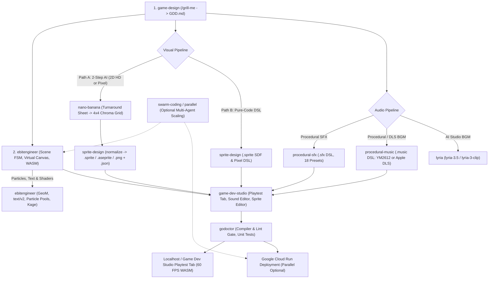

# Vibe Game Developer: Primary Entrypoint & Workflow Router

`vibe-game-developer` is the primary entrypoint for building 2D games in Go with Ebitengine (`github.com/hajimehoshi/ebiten/v2`) inside the `agy-game-studio` plugin bundle. It teaches you how to classify requests, choose between pure-code procedural and generative AI asset pipelines, open the interactive studio workbench, and compose specialized skills as modular building blocks.

> [!NOTE]
> **Genre-Agnostic & Modular Design**:
> Every skill in this bundle works as an independent, composable building block for any 2D genre. This includes top-down RPGs, bullet-heavens, twin-stick or vertical shmups, isometric tactics, roguelike deckbuilders, grid or physics puzzles, visual novels, rhythm games, and side-scrolling platformers. Never assume side-scrolling physics or a single fixed asset pipeline. Activate only the skills needed for the current task, and mix procedural DSL skills (`sprite-design`, `procedural-sfx`, `procedural-music`) with generative AI media skills (`nano-banana`, `lyria`) in pure or hybrid workflows.

---

## 1. Skill Ecosystem & Intent Routing Matrix

Each skill owns a distinct domain and works either standalone or as part of an end-to-end build:

| User Intent / Task | Target Skill | Role & Core Capabilities |
| :--- | :--- | :--- |
| **Co-Creation, MDA Aesthetics & GDD** | **[`game-design`](../game-design/SKILL.md)** | **Game Designer**: Runs a one-question-at-a-time `/grill-me` Socratic interview across any 2D genre, defines core loops and MDA aesthetics, locks in visual and audio pipeline choices, and writes `GDD.md`. |
| **Ebitengine 2D Architecture & WASM** | **[`ebitengineer`](../ebitengineer/SKILL.md)** | **Engine Architect**: Scaffolds the Ebitengine v2 loop, virtual resolution scaling, scene state machines and overlay stacks, fixed-timestep updates, zero-allocation `Draw()` loops, Kage shaders, and `GOOS=js GOARCH=wasm` builds. |
| **Sprites, Tilesets & Frame Animation** | **[`sprite-design`](../sprite-design/SKILL.md)** | **2D Technical Artist & Animator**: Supports both the 2-step AI Character Sheet to Sprite Grid pipeline (`normalize` into `.sprite`, `.png`, `.json`, and `.aseprite` at any resolution from `32x32` pixel art to `256x256+` 2D HD, like `black_cat_anime.*`) and the pure-code `.sprite` SDF/pixel DSL with zero-allocation `AnimationController`. |
| **Generative AI Art & Reference Sheets** | **[`nano-banana`](../nano-banana/SKILL.md)** | **AI Visual Artist**: Generates character turnaround sheets, raw animation grids on `#00FF00` or `#FF00FF` chroma-key backgrounds, parallax backgrounds, portraits, and card art via `gemini-nano-banana-2.1`, `gemini-3.1-flash-lite-image`, and `gemini-3-pro-image`. |
| **Procedural Game Sound Effects (`.sfx`)** | **[`procedural-sfx`](../procedural-sfx/SKILL.md)** | **SFX Designer**: Synthesizes 4-byte aligned (`&^ 3`) 16-bit 44.1 kHz stereo PCM sound cues in memory from `.sfx` DSL scripts with PolyBLEP anti-aliasing, 18 built-in presets, SVF filter sweeps, 16-bit Galois LFSR noise, and peak/DC validation. |
| **Procedural Chiptune & DLS Music (`.music`)** | **[`procedural-music`](../procedural-music/SKILL.md)** | **Procedural Music Composer**: Compiles polyphonic `.music` scores (8 to 12+ channels, verified `|` barlines, `~` cross-bar ties) into 4-byte aligned stereo PCM using either the pure-Go SEGA Mega Drive YM2612 + SN76489 engine or the macOS Apple CoreAudio real-instrument engine (`-apple` / `gs_instruments.dls`). |
| **Generative Studio AI Music** | **[`lyria`](../lyria/SKILL.md)** | **AI Music Composer**: Generates 44.1 kHz stereo soundtracks and 30-second loops via Google Lyria (`lyria-3.5` / `lyria-3-pro-preview` and `lyria-3-clip` / `lyria-3-clip-preview`), including custom lyrics, timestamped arrangements, and image-to-music generation. |
| **Interactive Visual Workbench** | **[`game-dev-studio`](../game-dev-studio/SKILL.md)** | **Studio Workbench Launcher**: Opens the **Game Dev Studio** side-panel UI (`Playtest` tab, `Sound` tab / **Sound Editor**, and `Sprites` tab / **Sprite Editor**) via `sidecar://` pills to playtest WASM builds with a 10s DVR and frame annotations, audition and edit `.sfx` and `.music` files, and inspect `.sprite` and `.aseprite` containers. |
| **Go Code Quality & Verification** | **[`godoctor`](../godoctor/SKILL.md)** | **Go Quality Gate**: Runs compiler and linter checks (`gofmt`, `goimports`, `go vet`, `golangci-lint`), safe edit gates (`smart_build`, `smart_edit`), TestQuery analytics, and Selene mutation testing. |
| **Parallel Multi-Agent Execution** | **[`swarm-coding`](../swarm-coding/SKILL.md)** & **[`parallel`](../parallel/SKILL.md)** | **Multi-Agent Coordinators**: Split large builds or asset batches across parallel subagents working on disjoint packages, files, or worktrees. |

---

## 2. Architecture & Workflow Composition



---

## 3. Asset Pipeline Decision Rules

Follow the pipeline choice recorded in `GDD.md`, or help the user pick the right combination when working ad-hoc.

### 3.1 Sprites, Visuals & Engine VFX (`sprite-design` + `nano-banana` + `ebitengineer`)

Always align with the user on animation motions, camera projection (side-profile, 3/4 top-down, `2:1` isometric, or front-facing ortho), resolution (`256x256+` 2D HD vs. `32x32`/`64x64` pixel art), and production path before generating character sheets or grids.

* **Path A: Two-Step AI Character Sheet to Sprite Grid (`nano-banana` + `sprite-design` `normalize`)**:
  - Best for expressive heroes, bosses, NPCs, creatures, and isometric units that need 4 or more motion tags (`idle`, `walk`, `run`, `jump`, `fall`, `crouch`, `sleep`, `attack`, `hit`, `death`).
  - **Step 1**: Use `nano-banana` (`gemini-nano-banana-2.1`) to create a character reference sheet with `1:2` to `1:3` game proportions, genre-matched camera projection, clear limb separation, and a 4-step color swatch bar.
  - **Step 2**: Pass the reference sheet via `-i` to `nano-banana` to generate uniform `4x4` animation grids on a flat `#00FF00` or `#FF00FF` chroma-key background with 10% to 15% safety margins around every cell. Then run `skills/sprite-design/scripts` `normalize` to strip the chroma key, prune boundary bleed, center and ground frames at native `256x256+` 2D HD or downsampled `64x64` pixel art, export `.png`, `.json`, `.aseprite`, and looping per-motion `.gif` previews, and wire Ebitengine's `NewGridSpriteSheet` and `AnimationController`.
* **Path B: Pure-Code Procedural `.sprite` DSL (`sprite-design`)**:
  - Best for zero-asset procedural builds, geometric enemies, vehicles, puzzle gems, projectiles, pickups, props, and seamless tilesets.
  - Author declarative `.sprite` files using Z-ordered `part` blocks, SDF and pixel primitives, 12 Retro-HD palettes, 12 4-step material ramps, and keyframed `tag`/`pose` animations. Validate with `go run . validate` and compile in memory (`CompileSpriteDSL`) or export to `.aseprite` and `.png`+`.json`.
* **Backgrounds, Portraits & Engine VFX (`nano-banana` + `ebitengineer`)**:
  - Use `nano-banana` for title screens, seamless `4:1` parallax backgrounds, visual novel portraits, and deckbuilder card art.
  - Use `ebitengineer` for runtime particle pools, `text/v2` HUD typography, 2D `GeoM` camera transforms, and Kage screen shaders.

### 3.2 Audio & Music Routing (`procedural-sfx` vs. `procedural-music` vs. `lyria`)

All audio buffers fed into Ebitengine's `audio.Context` or `audio.NewInfiniteLoop` must enforce 4-byte stereo sample frame alignment (`len(pcm) &^ 3`).

* **Choose [`procedural-sfx`](../procedural-sfx/SKILL.md)** when:
  - Designing low-latency gameplay sound effects in `.sfx` DSL (lasers, sword clashes, explosions, jumps, coins, UI ticks, footsteps, or engine loops) with zero external audio files.
  - Using the 18 built-in SFX presets, dynamic duty-cycle or SVF filter sweeps, 16-bit Galois LFSR chiptune noise (`wave=psg_noise`), and `ValidateProductionSFX` quality checks.
* **Choose [`procedural-music`](../procedural-music/SKILL.md)** when:
  - Composing original multi-channel background music in `.music` DSL (8 to 12+ independent channels, `30s` to `150s+` duration, verified `|` barlines, and `~` cross-barline ties) with sample-exact seamless looping (`audio.NewInfiniteLoop`) and tiny text file sizes.
  - Synthesizing either pure-Go SEGA Mega Drive YM2612 4-operator FM + SN76489 PSG chiptunes (`synth default`) or native macOS Apple CoreAudio real-instrument arrangements (`synth apple` / `-apple` backed by `gs_instruments.dls`).
* **Choose [`lyria`](../lyria/SKILL.md)** when:
  - Generating studio-recorded AI music tracks or vocal songs via **Lyria 3.5** (`lyria-3.5` / `lyria-3-pro-preview`) or 30-second loops via **Lyria 3 Clip** (`lyria-3-clip` / `lyria-3-clip-preview`).
  - Creating soundtracks directly from concept art or screenshots (multimodal image-to-music).
* **Choose a Hybrid Audio Pipeline** when:
  - Pairing `procedural-sfx` for instant, cooldown-rate-limited gameplay sound effects with either `procedural-music` (for sample-exact looping stage themes) or `lyria` (for cinematic vocal or orchestral tracks).

---

## 4. Interactive Workbench (`game-dev-studio`)

The `agy-game-studio` plugin includes the **Game Dev Studio** interactive side-panel workbench for human inspection, live WASM playtesting, and asset fine-tuning. All three tabs follow the same standardized menu pattern as Paint Studio (`agy-paint-studio`). Opening a registered file (`.music`, `.sfx`, `.sprite`, or `.aseprite`) opens **Game Dev Studio** with the relevant tab in focus:

1. **Playtest Tab in Game Dev Studio (`🎮 Playtest`)**:
   - Uses **Open Project** to select the desired Go project folder and main package, then **🚀 Run** to compile the Go game to WebAssembly (`GOOS=js GOARCH=wasm`) and run it at 60 FPS in the side panel. Records a 10-second (250-frame) DVR ring buffer for frame-by-frame scrubbing (`F8` or `` ` ``) and lets the user draw annotations (`Pen`, `Arrow`, `Box`, `Text`) to send `📸 Frame` PNG or `🎞️ 10s GIF` bug reports directly into chat.
   - Pill: `[Game Dev Studio](sidecar://agy-game-studio/studio/playtest)`
2. **Sound Tab in Game Dev Studio (`🎹 Sound` / Sound Editor)**:
   - Uses **Open File** (`.music` or `.sfx`), **Open Artifact** (browse/save session artifacts), **Save** (save `.music` or `.sfx` to filesystem or browser download), and **Export** (export `.wav` to filesystem or browser download), plus action buttons to toggle between **GUI** and **Text** mode and toggle the visualizer between **Wave** and **Spectrum** (`< 260 Hz` FFT), switch between `🎛️ YM2612` and `🍎 CoreAudio` synthesis, and solo (`S`) or mute (`M`) individual stems. Never auto-detects or populates a combo box with skill files.
   - General pill: `[Game Dev Studio (Sound Tab)](sidecar://agy-game-studio/studio/sound)` (or `[Sound Editor](sidecar://agy-game-studio/studio/sound)`)
   - File pill: `[laser.sfx](sidecar://agy-game-studio/studio/sound?file=/abs/path/to/laser.sfx)` or `[stage1.music](sidecar://agy-game-studio/studio/sound?file=/abs/path/to/stage1.music)`
3. **Sprite Tab in Game Dev Studio (`🎨 Sprites` / Sprite Editor)**:
   - Uses **Open File** (`.sprite` or `.aseprite`, never raw `.png` files), **Open Artifact** (browse/save session artifacts), **Save** (save `.sprite` to filesystem or browser download), and **Export** (export `.aseprite`, `.png` sheet, or `.json` manifest), plus action buttons for **Visual** / **`.sprite` Text** mode, **Play**/**Pause** (starts paused), **Speed**, and **Backdrop**, with per-frame prompt comments via `+ Note` and `Send`.
   - General pill: `[Game Dev Studio (Sprite Tab)](sidecar://agy-game-studio/studio/sprite)` (or `[Sprite Editor](sidecar://agy-game-studio/studio/sprite)`)
   - File pill: `[black_cat_anime.sprite](sidecar://agy-game-studio/studio/sprite?file=/abs/path/to/black_cat_anime.sprite)`

> [!TIP]
> **100% Headless CLI Compatibility**:
> Every compiler, normalizer, validator, and exporter in `sprite-design`, `procedural-sfx`, and `procedural-music` runs standalone from the terminal via `go run .` and `go test ./...` when operating in headless CLI workflows.

---

## 5. End-to-End Game Development Lifecycle

When guiding a user through building a complete 2D game from scratch, or running any single phase on demand:

1. **Co-Creation & GDD (`/grill-me`)**: Activate [`game-design`](../game-design/SKILL.md) to interview the user one question at a time, establish the core loop, camera perspective, MDA aesthetics, and visual/audio pipeline choice, and save `GDD.md`.
2. **Engine Scaffolding & Core Loop**: Activate [`ebitengineer`](../ebitengineer/SKILL.md) to set up `internal/` packages, virtual resolution scaling, scene state machine or overlay stack, fixed-timestep updates, and zero-allocation rendering.
3. **Sprites, Tilesets & Visual Assets**:
   - Confirm motion tags, camera projection, resolution (`256x256+` 2D HD vs. pixel art), and pipeline path with the user.
   - Activate [`nano-banana`](../nano-banana/SKILL.md) + [`sprite-design`](../sprite-design/SKILL.md) (`normalize`) for the 2-step AI Character Sheet to Sprite Grid pipeline, or [`sprite-design`](../sprite-design/SKILL.md) for pure-code `.sprite` DSL assets and tilesets.
   - Surface `[Sprite Editor](sidecar://agy-game-studio/studio/sprite)` (or a file-scoped `.sprite` pill) and embed per-motion `.gif` previews for visual verification.
4. **Sound Effects & Music**:
   - Activate [`procedural-sfx`](../procedural-sfx/SKILL.md) to create and validate `.sfx` cues.
   - Activate [`procedural-music`](../procedural-music/SKILL.md) to compose and validate multi-channel `.music` scores (pure-Go YM2612 or `-apple` CoreAudio DLS), or [`lyria`](../lyria/SKILL.md) for AI-generated soundtracks.
   - Surface `[Sound Editor](sidecar://agy-game-studio/studio/sound)` (or a file-scoped `.music`/`.sfx` pill) so the user can audition and mix tracks.
5. **Parallel Scaling (Optional)**: When building multiple orthogonal game packages or large asset batches simultaneously, activate [`swarm-coding`](../swarm-coding/SKILL.md) or [`parallel`](../parallel/SKILL.md) to coordinate subagents across disjoint file sets.
6. **Quality Verification, Localhost Playtesting & Cloud Run Deployment**:
   - Activate [`godoctor`](../godoctor/SKILL.md) to run compiler gates, linters, and unit tests.
   - Compile the WebAssembly build (`GOOS=js GOARCH=wasm`) with [`ebitengineer`](../ebitengineer/SKILL.md) and surface `[Game Dev Studio](sidecar://agy-game-studio/studio/playtest)` or a local HTTP server (`localhost:8080`) for live 60 FPS playtesting and 10s DVR inspection.
   - Coordinate with the developer on whether they want to playtest locally first, deploy to **Google Cloud Run**, or run the Cloud Run build and deployment **in parallel** while they test the game on `localhost` or in the **Playtest tab in Game Dev Studio**.

---

## 6. WebAssembly Compilation, Localhost Testing & Cloud Run Deployment

Once the game compiles cleanly (`go build ./...` and `GOOS=js GOARCH=wasm go build`), coordinate with the developer to decide how they want to run and ship the build:
- **Option A (Local Playtesting Only)**: Launch in `[Game Dev Studio](sidecar://agy-game-studio/studio/playtest)` or serve on `http://localhost:8080`.
- **Option B (Parallel Localhost Testing + Cloud Run Deployment)**: Start local playtesting (`Game Dev Studio` or `localhost:8080`) immediately while running the Google Cloud Run container build and deployment in parallel via a background task or a [`parallel`](../parallel/SKILL.md) subagent so the developer never waits idle during container builds.
- **Option C (Cloud Run Deployment Direct)**: Package and deploy the WebAssembly build and Go HTTP server directly to Google Cloud Run.

### 6.1 Compile to WebAssembly & Run on Localhost

Build `game.wasm`, copy Go's `wasm_exec.js` runtime shim from `GOROOT`, and serve `public/` (see [`ebitengineer/references/server_architecture.md`](../ebitengineer/references/server_architecture.md) for the full `cmd/server/main.go` and `index.html` templates):

```bash
# 1. Create public web directory and compile the Ebitengine game to WASM
mkdir -p public
GOOS=js GOARCH=wasm go build -o public/game.wasm ./cmd/game

# 2. Copy wasm_exec.js from the active Go toolchain (supports Go 1.24+ lib/wasm and older misc/wasm)
GOROOT_DIR="$(go env GOROOT)"
if [ -f "$GOROOT_DIR/lib/wasm/wasm_exec.js" ]; then
  cp "$GOROOT_DIR/lib/wasm/wasm_exec.js" public/wasm_exec.js
else
  cp "$GOROOT_DIR/misc/wasm/wasm_exec.js" public/wasm_exec.js
fi

# 3. Run the local Go HTTP server on http://localhost:8080 (or click Run in the Playtest tab in Game Dev Studio)
PORT=8080 go run ./cmd/server
```

### 6.2 Containerize & Deploy to Google Cloud Run

Use a multi-stage `Dockerfile` that compiles `public/game.wasm`, bundles `wasm_exec.js` and `index.html`, and builds a static Go HTTP server listening on `$PORT` (default `8080`):

```dockerfile
FROM golang:1.26-alpine AS builder
WORKDIR /app
COPY go.mod go.sum ./
RUN go mod download
COPY . .

# 1. Compile Ebitengine game to WebAssembly
RUN mkdir -p public && \
    GOOS=js GOARCH=wasm go build -o public/game.wasm ./cmd/game && \
    if [ -f "$(go env GOROOT)/lib/wasm/wasm_exec.js" ]; then \
      cp "$(go env GOROOT)/lib/wasm/wasm_exec.js" public/wasm_exec.js; \
    else \
      cp "$(go env GOROOT)/misc/wasm/wasm_exec.js" public/wasm_exec.js; \
    fi && \
    cp index.html public/

# 2. Compile the static Go HTTP server (embeds public/*)
RUN CGO_ENABLED=0 GOOS=linux go build -o /server ./cmd/server

FROM gcr.io/distroless/static-debian12
COPY --from=builder /server /server
EXPOSE 8080
ENTRYPOINT ["/server"]
```

Build and deploy the service to Google Cloud Run (can be executed in the background or delegated to a subagent while the developer tests on `localhost`):

```bash
# Verify active GCP project and region
GCP_PROJECT="$(gcloud config get-value project)"
SERVICE_NAME="ebiten-wasm-game"
REGION="us-central1"

# Submit container build and deploy to Cloud Run
gcloud builds submit --tag "gcr.io/${GCP_PROJECT}/${SERVICE_NAME}"
gcloud run deploy "${SERVICE_NAME}" \
  --image "gcr.io/${GCP_PROJECT}/${SERVICE_NAME}" \
  --platform managed \
  --region "${REGION}" \
  --allow-unauthenticated
```

When deployment finishes, return the live `https://*.run.app` URL to the developer so they can share or test the hosted WebAssembly build in any browser.
