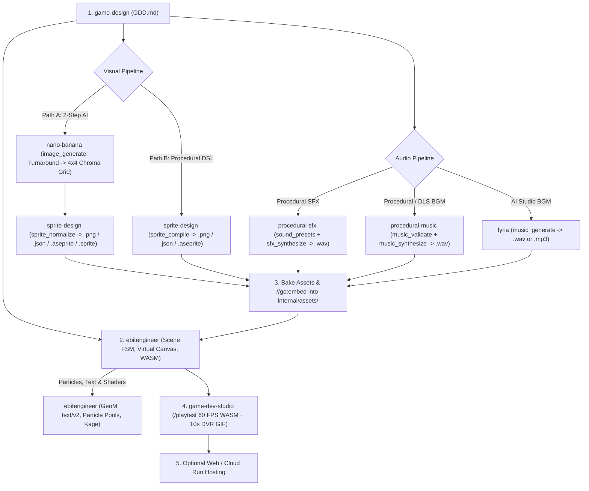

# Vibe game developer: 2D Go game workflow router

`vibe-game-developer` is the main workflow router for building 2D games in Go with [Ebitengine v2](https://ebitengine.org/) (`github.com/hajimehoshi/ebiten/v2`) using the **Antigravity 2D Game Studio** (`agy-game-studio`) plugin. Use it to choose between pure-code procedural and generative AI asset pipelines, invoke the bundled `game-studio` MCP tools, embed baked assets into your game with `//go:embed`, and open the Game Dev Studio side panel.

> [!NOTE]
> **Genre-agnostic and modular design**:
> Every skill in this plugin works for any 2D genre, including top-down RPGs, bullet-heavens, vertical or twin-stick shmups, `2:1` isometric tactics, roguelike deckbuilders, grid or physics puzzles, visual novels, rhythm games, and side-scrolling platformers. Never assume side-scrolling gravity or one fixed asset pipeline. Activate only the skills needed for the task, and combine procedural DSL tools (`sprite-design`, `procedural-sfx`, `procedural-music`) with generative media tools (`nano-banana`, `lyria`) as needed.

---

## Bundled skill ecosystem (9 plugin skills)

`agy-game-studio` bundles `vibe-game-developer` alongside 8 specialized companion skills:

| User Intent / Task | Target Skill | Role, MCP Tools & Studio Integration |
| :--- | :--- | :--- |
| **Game design and GDD creation** | `game-design` | **Game Designer**: Runs one-decision-at-a-time discovery across any 2D genre, locks visual and audio pipeline choices, and writes `GDD.md`. |
| **Ebitengine architecture and WASM** | `ebitengineer` | **Engine Architect**: Designs `internal/` packages, virtual canvas scaling, scene FSM, fixed-timestep simulation, zero-allocation `Draw()`, Kage shaders, `//go:embed` asset loading, and `GOOS=js GOARCH=wasm` builds. |
| **Sprites, tilesets, and animation** | `sprite-design` | **2D Technical Artist**: Normalizes raw AI grids (`sprite_normalize`), compiles `.sprite` SDF/pixel DSL (`sprite_compile`), inspects `.sprite`/`.aseprite`/`.png` sheets (`sprite_inspect`), and extracts shading ramps (`sprite_extract_palette`). |
| **Generative art and sprite grids** | `nano-banana` | **AI Visual Artist**: Calls `image_generate` (`nano-banana-2.1`, `nano-banana-2`, `nano-banana-2-lite`, `nano-banana-pro`) for character turnaround sheets, `4x4` chroma-key animation grids, `4:1` parallax layers, portraits, and cards. |
| **Procedural SFX (`.sfx`)** | `procedural-sfx` | **SFX Designer**: Lists built-in archetypes (`sound_presets`) and synthesizes 44.1 kHz stereo WAV sound cues (`sfx_synthesize`) with PolyBLEP, SVF filters, LFSR noise, and acoustic QA validation. |
| **Procedural BGM (`.music`)** | `procedural-music` | **Procedural Composer**: Checks music theory and barlines (`music_validate`) and renders polyphonic `.music` scores (`music_synthesize`, SEGA YM2612/PSG or macOS `apple: true` CoreAudio) to `.wav` and stems. |
| **Generative AI music** | `lyria` | **AI Music Composer**: Calls `music_generate` (`lyria-3.5`, `lyria-3-clip-preview`, `lyria-3-pro-preview`) for 44.1 kHz stereo `.mp3` or `.wav` soundtracks, vocal tracks with lyrics (`outLyricsPath`), and image-to-music cues. |
| **Side-panel playtest launcher** | `game-dev-studio` | **Studio UI Launcher**: Surfaces a `[Game Dev Studio](sidecar://agy-game-studio/studio/playtest)` pill to open the `/playtest` panel in the auxiliary pane. |

### Optional external tools (not bundled in this plugin)

If your workspace environment separately provides external Go verification or refactoring helpers (such as `godoctor`, `golangci-lint`, or `deadcode`) or multi-agent task runners, you can use them alongside `go test ./...` and `GOOS=js GOARCH=wasm go build` to speed up large builds or tighten static checks. They are optional external helpers, not bundled `agy-game-studio` skills.

---

## Bundled `game-studio` MCP tools and Playtest panel

The plugin runs the headless Go `game-studio` MCP server (`mcp_config.json`) with **10 tools** alongside the **Game Dev Studio** Playtest side panel:

| Surface | Tools / Panel | What They Do |
| :--- | :--- | :--- |
| **`game-studio` MCP Audio** | `sound_presets`, `sfx_synthesize`, `music_validate`, `music_synthesize`, `music_generate` | Lists SFX/music presets, validates `.music` scores, renders `.sfx` and `.music` scripts to `.wav` and stems, and generates AI `.mp3`/`.wav` tracks with Lyria. |
| **`game-studio` MCP Sprite & Image** | `sprite_inspect`, `sprite_compile`, `sprite_normalize`, `sprite_extract_palette`, `image_generate` | Generates AI art and `4x4` grids with Nano Banana, strips chroma backgrounds and packs `.png`/`.json`/`.aseprite`/`.sprite`/`.gif`, compiles `.sprite` DSL, and extracts 4-step shading ramps. |
| **Game Dev Studio (`/playtest`)** | `sidecar://agy-game-studio/studio/playtest` | Compiles your Go Ebitengine project to WASM and runs it at 60 FPS with a 10-second DVR rewind buffer, bug annotation tools, and animated GIF export. |

---

## Architecture and workflow composition



---

## Asset pipeline decision rules and baked `//go:embed` flow

Follow the pipeline recorded in `GDD.md`, or align with the user first. Because the `game-studio` MCP server handles all synthesis, compilation, normalization, and AI generation directly on your development machine, your Go game does **not** need runtime synthesis code or API clients: bake final `.png`, `.json`, `.aseprite`, `.wav`, and `.mp3` files under `internal/assets/` and embed them into the binary with `//go:embed`.

### Sprites, visuals, and engine VFX

Confirm animation tags, camera projection (`2D side-profile`, `3/4 top-down`, `2:1 isometric`, or `front-facing ortho`), frame resolution (`256x256+` Native 2D HD vs. `32x32`/`64x64` pixel art), and production path first:

- **Path A: Two-step AI character sheet to sprite grid (`nano-banana` + `sprite-design`)**:
  - Best for expressive heroes, bosses, NPCs, creatures, and isometric units with 4 or more motion tags.
  - **Step 1**: Call `image_generate` (`model: "nano-banana-2.1"`) to create a turnaround sheet with `1:2` to `1:3` proportions, matching camera projection, clear limb separation, and a 4-step color swatch bar.
  - **Step 2**: Pass that sheet in `inputImages` to `image_generate` to create uniform `4x4` animation grids on `#00FF00` or `#FF00FF` chroma-key backgrounds with at least 15% empty cell margins. Then call `sprite_normalize` to strip chroma backgrounds, center and ground frames, and write `.png`, `.json`, `.aseprite`, `.sprite`, and preview GIFs.
- **Path B: Pure-code procedural `.sprite` DSL (`sprite-design`)**:
  - Best for crisp geometric enemies, projectiles, pickups, props, and seamless tilesets.
  - Write `.sprite` files using Z-ordered `part` blocks, SDF and pixel primitives, 12 Retro-HD palettes, 12 four-step material ramps (or ramps extracted via `sprite_extract_palette`), and `tag`/`pose` animations. Call `sprite_compile` to validate QA metrics and export baked `.png`, `.json`, `.aseprite`, and preview GIFs into `internal/assets/`.
- **Backgrounds, portraits, and runtime VFX (`nano-banana` + `ebitengineer`)**:
  - Use `image_generate` (`aspectRatio: "4:1"` for seamless parallax layers, `"1:1"` or `"3:4"` for portraits and cards).
  - Use `ebitengineer` for pre-allocated particle pools, `text/v2` HUD typography, 2D `GeoM` transforms, and Kage shaders.
- **Inspect baked sprites**: Inspect generated `outPreviewPath` PNGs and `outGifDir` animations directly or check QA metrics with `sprite_inspect`.

### Audio and music

All PCM buffers passed to Ebitengine's `audio.Context` or `audio.NewInfiniteLoop` must enforce 4-byte stereo sample frame alignment (`len(pcm) &^ 3`) at `44100` Hz.

- **Choose `procedural-sfx`**: Call `sound_presets` to inspect the 18 built-in archetypes, then author `.sfx` scripts and call `sfx_synthesize` with `outWavPath` to bake click-free 16-bit 44.1 kHz stereo `.wav` cues for lasers, hits, jumps, coins, and UI ticks.
- **Choose `procedural-music`**: Compose polyphonic `.music` scores (`8` to `12+` tracks, `30s` to `150s+`, verified `|` barlines, `~` cross-bar ties). Run `music_validate` for music-theory and duration checks, then call `music_synthesize` (default pure-Go YM2612 + SN76489, or `apple: true` on macOS CoreAudio) with `outWavPath` to bake sample-exact loopable `.wav` music.
- **Choose `lyria`**: Call `music_generate` (`lyria-3.5` default for `.wav` or `.mp3`, `lyria-3-clip-preview` for 30s `.mp3` clips, `lyria-3-pro-preview` for long `.mp3` songs) for orchestral, vocal, or image-inspired tracks. Prefer `.wav` (`lyria-3.5` + `apiMode: "interactions"`) for gapless gameplay loops so MP3 encoder priming padding does not pop at loop boundaries.

### Fail-fast credential policy

`image_generate` and `music_generate` authenticate using Vertex AI / Gemini Enterprise Application Default Credentials (`GOOGLE_CLOUD_PROJECT`, `GOOGLE_CLOUD_LOCATION="global"`, `GOOGLE_GENAI_USE_ENTERPRISE="true"`, `gcloud auth application-default login`) or `GEMINI_API_KEY` / `GOOGLE_API_KEY`. If authentication fails, **stop immediately**, report the exact error and remediation steps, and never fabricate mock assets or silently switch models.

---

## End-to-end lifecycle, Playtest panel, and deployment

1. **Game design (`game-design`)**: Run focused discovery to lock mechanics, virtual resolution, controls, and pipeline choices into `GDD.md`.
2. **Engine scaffolding (`ebitengineer`)**: Scaffold `internal/` packages, virtual resolution scaling, scene FSM, fixed-timestep `60 TPS` loop, and `internal/assets` `//go:embed` loaders.
3. **Visual assets (`nano-banana` + `sprite-design`)**: Confirm motion tags, projection, and resolution, then execute Path A (`image_generate` -> `sprite_normalize`) or Path B (`.sprite` DSL -> `sprite_compile`), baking `.png`/`.json`/`.aseprite` assets into `internal/assets/`.
4. **Audio assets (`procedural-sfx`, `procedural-music`, `lyria`)**: Synthesize `.sfx` and `.music` scores or generate Lyria tracks via MCP tools, baking `.wav`/`.mp3` files into `internal/assets/`.
5. **Playtest and verify (`game-dev-studio` + `ebitengineer`)**: Run `go test ./...` and `GOOS=js GOARCH=wasm go build -o /dev/null ./cmd/game` (plus any optional external Go linters if installed). Surface `[Game Dev Studio](sidecar://agy-game-studio/studio/playtest)` so the user can launch the live 60 FPS WASM game, test gameplay, and capture annotated screenshots or 10-second DVR GIF bug reports.
6. **Optional standalone WASM server and Cloud Run deployment**:

```bash
mkdir -p public
GOOS=js GOARCH=wasm go build -o public/game.wasm ./cmd/game

GOROOT_DIR="$(go env GOROOT)"
if [ -f "$GOROOT_DIR/lib/wasm/wasm_exec.js" ]; then
  cp "$GOROOT_DIR/lib/wasm/wasm_exec.js" public/wasm_exec.js
else
  cp "$GOROOT_DIR/misc/wasm/wasm_exec.js" public/wasm_exec.js
fi

PORT=8080 go run ./cmd/server
```

```dockerfile
FROM golang:1.27-alpine AS builder
WORKDIR /app
COPY go.mod go.sum ./
RUN go mod download
COPY . .

RUN mkdir -p public && \
    GOOS=js GOARCH=wasm go build -o public/game.wasm ./cmd/game && \
    if [ -f "$(go env GOROOT)/lib/wasm/wasm_exec.js" ]; then \
      cp "$(go env GOROOT)/lib/wasm/wasm_exec.js" public/wasm_exec.js; \
    else \
      cp "$(go env GOROOT)/misc/wasm/wasm_exec.js" public/wasm_exec.js; \
    fi && \
    cp index.html public/

RUN CGO_ENABLED=0 GOOS=linux go build -o /server ./cmd/server

FROM gcr.io/distroless/static-debian12
COPY --from=builder /server /server
EXPOSE 8080
ENTRYPOINT ["/server"]
```

```bash
SERVICE_NAME="ebiten-wasm-game"
REGION="us-central1"

gcloud run deploy "${SERVICE_NAME}" \
  --source . \
  --region "${REGION}" \
  --allow-unauthenticated
```
